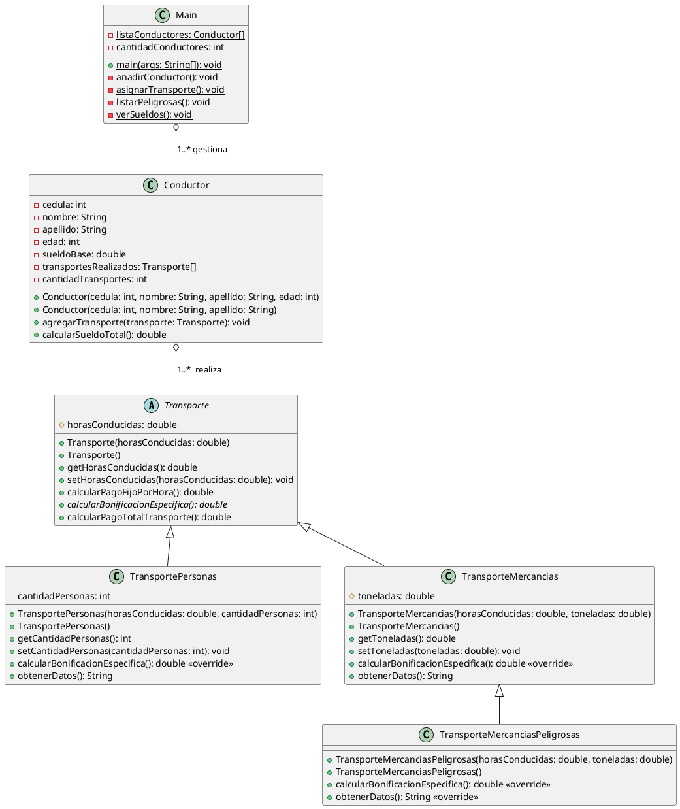
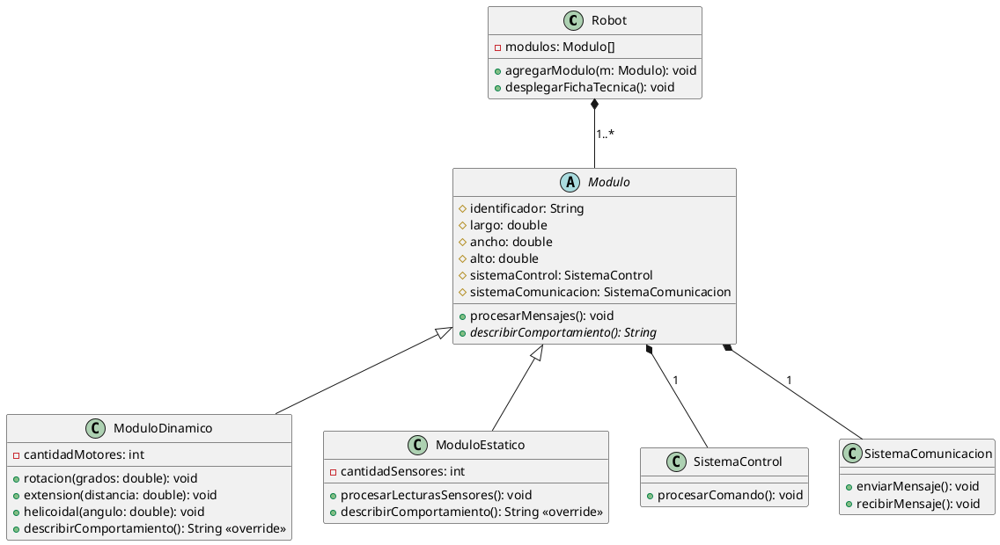

Universidad Católica Andrés Bello

Programación Orientada a Objetos

Profesora: Jannelly Bello

Laboratorio 2: POO Básico + UML

Semana 5 — Martes

Integrantes

Alessandro Pérez — 31.831.783

Jade {apellido} — {cédula}

17 de octubre de 2026

## Tabla de Contenidos

1. [[#1. Diagramas de Clases UML|Diagramas de Clases UML]]
2. [[#2. Ficha Técnica de Clases del Ejercicio Implementado (Ejercicio 1)|Ficha Técnica de Clases del Ejercicio Implementado (Ejercicio 1)]]
3. [[#3. Entradas, Polimorfismo y Arreglos|Entradas, Polimorfismo y Arreglos]]
4. [[#4. Screenshots de Pruebas|Screenshots de Pruebas]]

## 1. Diagramas de Clases UML

### 1.1 Ejercicio 1 — Sistema de Control de Sueldos y Transportes

### 1.2 Ejercicio 2 — Robots Modulares

### 1.3 Relaciones y Cardinalidades

- **Herencia:** Se utiliza para modelar las especializaciones tanto en Transportes (Personas, Mercancías) como en Módulos (Dinámicos, Estáticos), permitiendo compartir código (atributos y métodos base) y promoviendo el polimorfismo mediante métodos abstractos.
- **Composición:** Utilizada en el Ejercicio 2 para definir que cada `Modulo` *posee obligatoriamente* (nace y muere con él) un `SistemaControl` y un `SistemaComunicacion` (cardinalidad 1 a 1).
- **Agregación (o Asociación Fuerte):** En el Ejercicio 1, un `Conductor` tiene una colección (arreglo estático) de `Transporte` (de 0 a muchos). Estos transportes podrían existir conceptualmente, pero se asocian al conductor que los realiza. De la misma manera, `Main` agrega objetos `Conductor`. En el Ejercicio 2, el `Robot` agrega un conjunto (de 1 a muchos) de piezas (`Modulo`).

## 2. Ficha Técnica de Clases del Ejercicio Implementado (Ejercicio 1)

### 2.1 `Transporte` *(abstracta)*

| Campo | Detalle |
|---|---|
| **Subclases** | `TransportePersonas`, `TransporteMercancias` |
| **Atributos** | `# horasConducidas: double` |
| **Constructores** | `Transporte(double)`, `Transporte()` *(sobrecargado)* |
| **Métodos** | `getHorasConducidas()`, `setHorasConducidas()`, `calcularPagoFijoPorHora()`, `calcularPagoTotalTransporte()`, `calcularBonificacionEspecifica()` *(abstracto)* |

### 2.2 `TransportePersonas` *(concreta)*

| Campo | Detalle |
|---|---|
| **Subclases** | Ninguna |
| **Atributos** | `- cantidadPersonas: int` |
| **Constructores** | `TransportePersonas(double, int)`, `TransportePersonas()` *(sobrecargado)* |
| **Métodos** | `@Override calcularBonificacionEspecifica()`, `obtenerDatos()`, `get/set` |

### 2.3 `TransporteMercancias` *(concreta)*

| Campo | Detalle |
|---|---|
| **Subclases** | `TransporteMercanciasPeligrosas` |
| **Atributos** | `# toneladas: double` |
| **Constructores** | `TransporteMercancias(double, double)`, `TransporteMercancias()` *(sobrecargado)* |
| **Métodos** | `@Override calcularBonificacionEspecifica()`, `obtenerDatos()`, `get/set` |

### 2.4 `TransporteMercanciasPeligrosas` *(concreta)*

| Campo | Detalle |
|---|---|
| **Subclases** | Ninguna |
| **Atributos** | Hereda `# toneladas` y `# horasConducidas` |
| **Constructores** | `TransporteMercanciasPeligrosas(double, double)`, `TransporteMercanciasPeligrosas()` *(sobrecargado)* |
| **Métodos** | `@Override calcularBonificacionEspecifica()`, `@Override obtenerDatos()` |

### 2.5 `Conductor` *(concreta)*

| Campo | Detalle |
|---|---|
| **Subclases** | Ninguna |
| **Atributos** | `- cedula: int`; `- nombre: String`; `- apellido: String`; `- edad: int`; `- sueldoBase: double`; `- transportesRealizados: Transporte[]`; `- cantidadTransportes: int` |
| **Constructores** | `Conductor(int, String, String, int)`, `Conductor(int, String, String)` *(sobrecargado)* |
| **Métodos** | `agregarTransporte(Transporte)`, `calcularSueldoTotal()`, `get/set` generales |

## 3. Entradas, Polimorfismo y Arreglos

### 3.1 E/S Híbrida: Scanner (consola) + JOptionPane (diálogos modales)

La aplicación cumple con el requisito estricto de combinar las dos tecnologías de E/S nativas de Java. El menú principal de la aplicación reside en un ciclo que depende completamente de `java.util.Scanner` para imprimir opciones por consola (`System.out.println`) y capturar la navegación básica del usuario. Sin embargo, al momento de requerir operaciones precisas y captura de objetos de negocio (como pedir los datos de un nuevo conductor o la carga de un camión), el flujo invoca métodos que utilizan exclusivamente `javax.swing.JOptionPane`. Esto se logró removiendo el componente `JFrame` general anterior, de modo que el ciclo lógico de la terminal controla la ejecución y despliega cuadros de diálogo modales gráficos de entrada (`showInputDialog`) y salida (`showMessageDialog`) de forma híbrida e intercalada, satisfaciendo estrictamente el requerimiento del enunciado.

### 3.2 Arreglos estáticos y polimorfismo en tiempo de ejecución

El almacenamiento de las entidades se diseñó descartando colecciones dinámicas (`ArrayList`) y empleando en su lugar arreglos estáticos del tipo base (`Conductor[]` y `Transporte[]`) controlados mediante variables contadoras (`cantidadConductores`, `cantidadTransportes`). El polimorfismo se aplica en tiempo de ejecución al asignar instancias de las subclases (ej. `new TransportePersonas()`, `new TransporteMercanciasPeligrosas()`) dentro del arreglo padre (`Transporte[]`). Durante el cálculo de sueldos o reportes, el código itera este arreglo nativo y al ejecutar `t.calcularBonificacionEspecifica()` o validar con `instanceof`, la JVM resuelve de forma dinámica cuál sobrescritura del comportamiento abstracto debe llamar sin importar que todos estén declarados bajo el arreglo del tipo estático base.

## 4. Screenshots de Pruebas

**Captura 1: Consola de ejecución mostrando el menú de Scanner**

![[Screenshot_20261017_012054.png]]

**Captura 2: Cuadro de diálogo JOptionPane para añadir conductor**

![[Screenshot_20261017_012146.png]]

**Captura 3: JOptionPane de asignación de transporte (selección múltiple)**

![[Screenshot_20261017_012241.png]]

**Captura 4: Cuadro de diálogo del informe de sueldos**

![[Screenshot_20261017_012347.png]]
