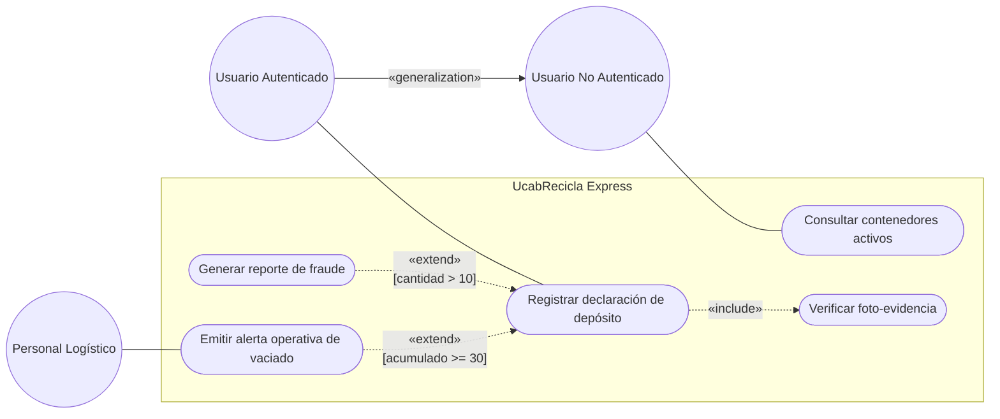
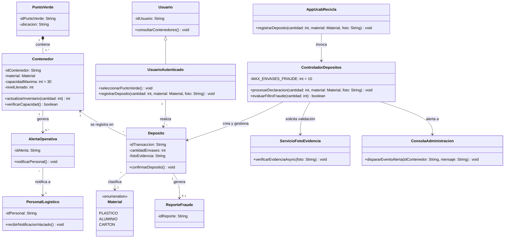
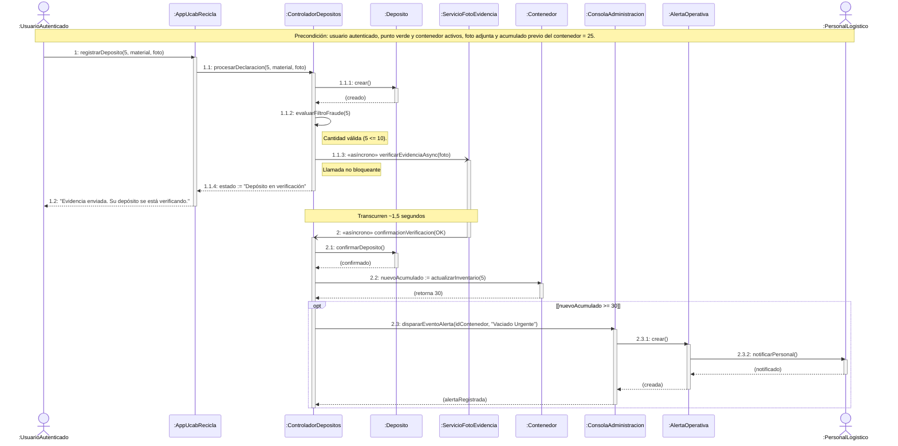
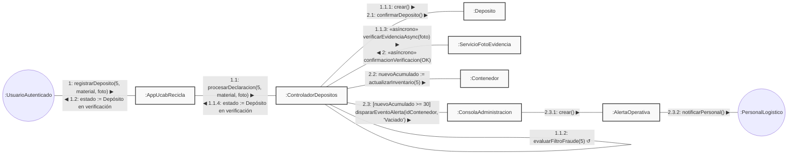

# Análisis del Caso de Estudio: UcabRecicla Express (Versión Corregida)

A continuación se presentan los diagramas UML corregidos, garantizando la consistencia entre ellos y el cumplimiento de la notación UML 2.5 y la sintaxis de Mermaid.

### 1. Diagrama de Casos de Uso

### 2. Diagrama de Clases

### 3. Diagrama de Secuencia

### 4. Diagrama de Colaboración (Comunicación)

---

### Lista de Cambios (Changelog de Errores)

**Casos de Uso:**
* **CU-1**: Se reemplazó `<<...>>` por las comillas angulares `«include»` y `«extend»`.
* **CU-2**: La flecha `UA -. "Es un" .-> U` se cambió por una línea continua `UA -- "«generalization»" --> U`.
* **CU-3**: Se reemplazaron las flechas direccionales (`-->`) por asociaciones sin punta de flecha (`---`) entre actores y casos de uso.
* **CU-4**: Se eliminó la relación del Personal Logístico con "Generar reporte de fraude".
* **CU-5**: Se eliminaron los pasos internos (UC3 y UC6) y se hicieron las extensiones directamente sobre el caso de uso base UC2.
* **CU-6**: Se actualizó la guarda de la extensión a `[acumulado >= 30]`.

**Clases:**
* **CL-1**: Se dividió en `PuntoVerde` y `Contenedor` estableciendo una composición `*--`. Los atributos y métodos operativos pasaron a `Contenedor`.
* **CL-2**: Se añadieron las clases `Usuario`, `UsuarioAutenticado` (con herencia), y `PersonalLogistico`, creando su asociación con `AlertaOperativa`.
* **CL-3**: Se agregó `ReporteFraude`, el atributo constante `-MAX_ENVASES_FRAUDE = 10` y el método `evaluarFiltroFraude(cantidad: int)`.
* **CL-4**: Se eliminaron los atributos inventados (`credenciales`, `estadoProceso`, `fecha`, etc.) conservando identificadores.
* **CL-5**: Se corrigió la composición por una asociación simple `-->` entre `Contenedor` y `AlertaOperativa`, quitando el texto de la etiqueta.
* **CL-6**: Se eliminaron las comillas de las asociaciones en el renderizado y se adaptaron atributos/métodos a la notación estricta UML (`-idUsuario: String`).

**Secuencia:**
* **SEC-1**: Se añadieron las clases faltantes de control y entidad al diagrama de clases (`AppUcabRecicla`, `ControladorDepositos`, `ConsolaAdministracion`, `ServicioFotoEvidencia`), igualando todos los nombres, participantes y métodos.
* **SEC-2**: Se numeró explícitamente todo el árbol de mensajes (1, 1.1, 1.1.1, 2, 2.1...).
* **SEC-3**: Se usó la flecha `-)` para los mensajes asíncronos y se extendió la activación del servicio de foto `VF` desde la petición hasta el retorno.
* **SEC-4**: Se reescribió la precondición enfocada puramente en estados previos (añadiendo el acumulado previo del contenedor = 25).
* **SEC-5**: Se completó el flujo `opt` enviando el mensaje `notificarPersonal()` al `PersonalLogistico` a través de la clase `AlertaOperativa`.

**Colaboración:**
* **COL-1**: Se añadió el mensaje reflexivo `evaluarFiltroFraude` en `CTRL` y se colocaron los retornos de estados de verificación hacia `APP` y `UA`.
* **COL-2**: Se estructuró el mensaje como `nuevoAcumulado := actualizarInventario(5)`.
* **COL-3**: Se eliminaron los corchetes `[]` para la condición de asincronía y se implementó como el texto `«asíncrono»`.
* **COL-4**: Todos los objetos se renombraron con el formato de instancia `:Clase`, idénticos al diagrama de secuencia.