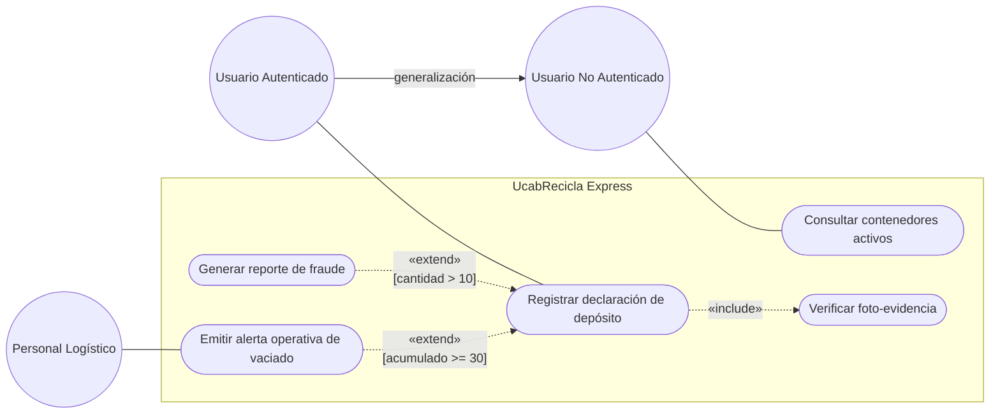
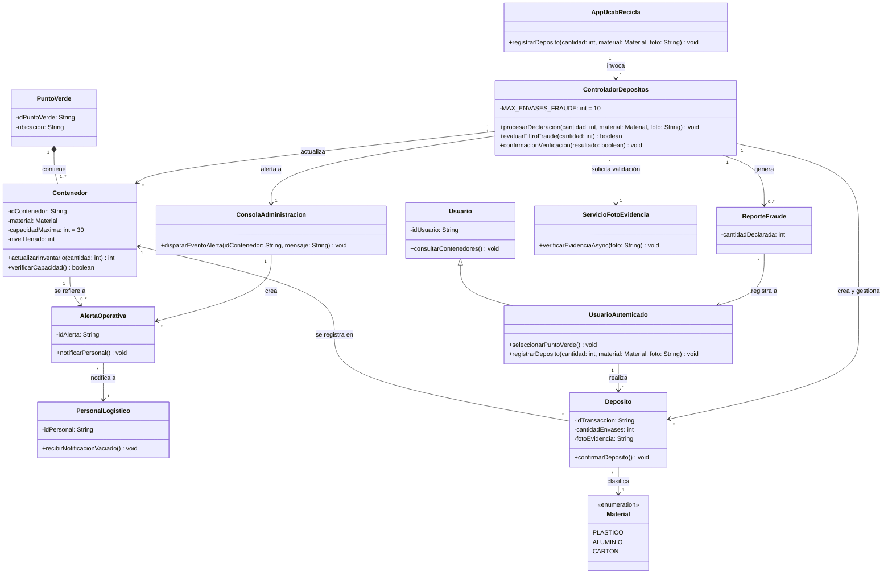
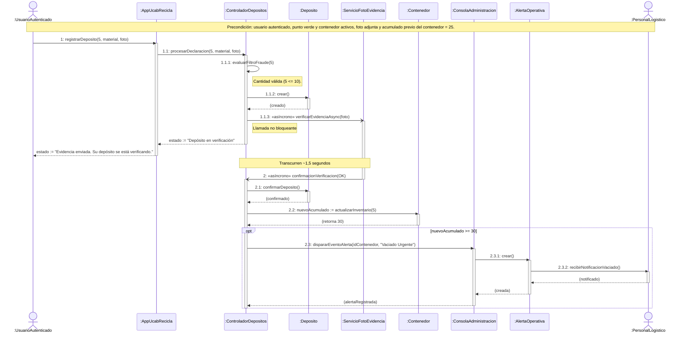
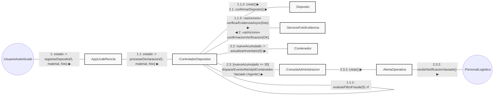

# Análisis del Caso de Estudio: UcabRecicla Express (Versión Final)

A continuación se presentan los diagramas UML corregidos, garantizando la consistencia entre ellos y el cumplimiento estricto de la notación UML 2.5 y la sintaxis de Mermaid.

### 1. Diagrama de Casos de Uso

### 2. Diagrama de Clases

### 3. Diagrama de Secuencia

### 4. Diagrama de Colaboración (Comunicación)

---

### Lista de Cambios y Correcciones Realizadas

*   **CU-2**: Se actualizó el texto sobre la línea a `"generalización"` sin usar el estereotipo. (Nota: los diagramas `flowchart` de Mermaid no soportan la línea de generalización con el triángulo hueco como el `classDiagram`; por tanto se representa con línea sólida y la etiqueta explícita tal cual solicitaste).
*   **SEC-1**: 
    * Se cambió el mensaje enviado al Personal Logístico a `2.3.2: recibirNotificacionVaciado()` en la secuencia y colaboración.
    * Se agregó la operación pública `+confirmacionVerificacion(resultado: boolean) void` a la clase `ControladorDepositos` para dar coherencia al mensaje asíncrono de retorno `2`.
*   **COL-2**: Se eliminó la numeración tipo "mensaje nuevo" en los valores de retorno. En el diagrama de secuencia las respuestas asíncronas son simples flechas `-->>` con texto; en el de colaboración se embutió la respuesta como una asignación (`1.1: estado := procesarDeclaracion(...)`).
*   **SEC-6**: Se corrigió el orden temporal. Ahora `1.1.1` es la evaluación de fraude (`evaluarFiltroFraude`) para validar los datos antes del registro, y `1.1.2` pasó a ser la instanciación de la entidad `Deposito` (`crear()`). Se renumeró idénticamente en colaboración.
*   **CL-7**: Se agregaron las asociaciones faltantes en el diagrama de clases (`ControladorDepositos --> Contenedor` y `ConsolaAdministracion --> AlertaOperativa`). Adicionalmente, el vínculo entre `Contenedor` y `AlertaOperativa` se corrigió de "genera" a "se refiere a".
*   **CL-8**: Se agregaron multiplicidades en ambos extremos a las 6 relaciones de dependencia/arquitectura indicadas (`"1" --> "1"`, `"1" --> "*"`, `"1" --> "0..*"`).
*   **CL-9**: El `ReporteFraude` ahora lo "genera" el `ControladorDepositos` (0..*) y el reporte "registra a" un (1) `UsuarioAutenticado`. Se eliminó el `idReporte` y el vínculo con el Depósito; se agregó el atributo de negocio `-cantidadDeclarada: int` a la clase de reporte.
*   **SEC-7**: Se eliminaron los corchetes dobles de la guarda en Mermaid mediante la sintaxis nativa `opt nuevoAcumulado >= 30`.
*   **COL-5**: Se ajustaron los parámetros del método de alerta en el diagrama de colaboración para que fueran exactamente `'Vaciado Urgente'`, haciendo espejo literal con la llamada de la secuencia.