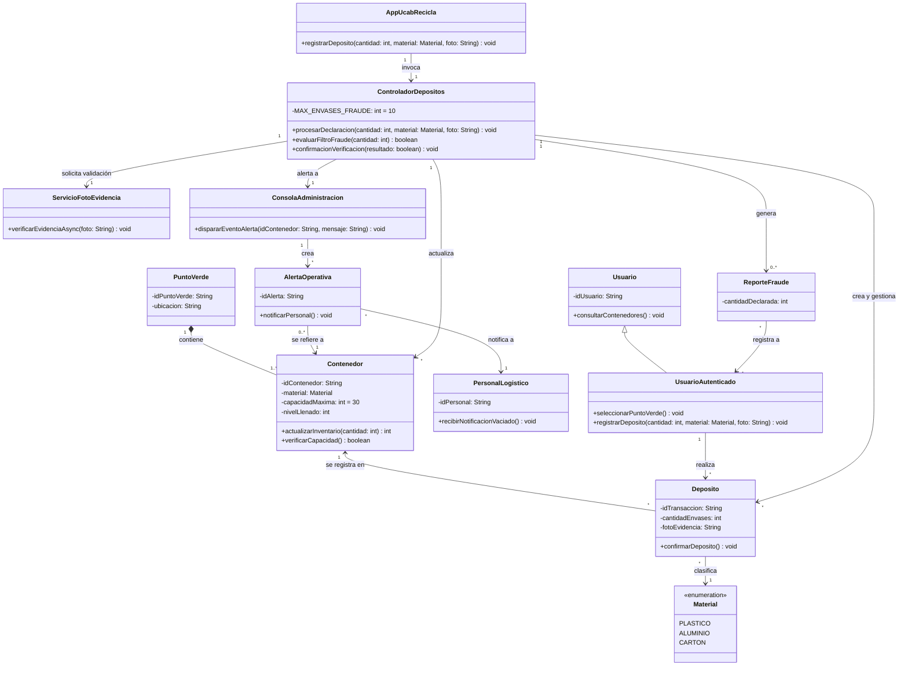
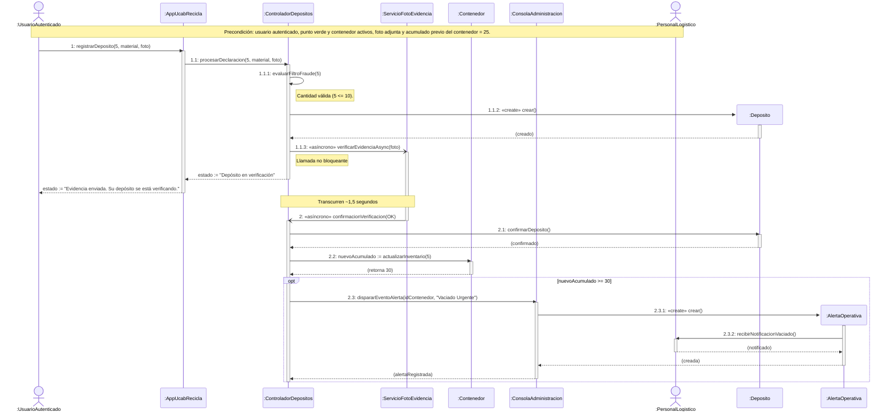
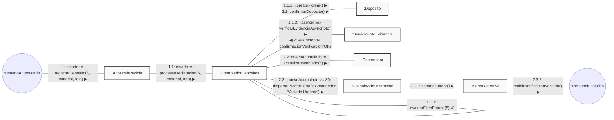

# Análisis del Caso de Estudio: UcabRecicla Express (Versión Final)

A continuación se presentan los diagramas UML corregidos, garantizando la consistencia entre ellos y el cumplimiento estricto de la notación UML 2.5 y la sintaxis de Mermaid.

### 2. Diagrama de Clases

### 3. Diagrama de Secuencia

### 4. Diagrama de Colaboración (Comunicación)

---

### Lista de Cambios por ID

*   **CL-10**: En el diagrama de clases, invertí la navegabilidad de la relación para que refleje correctamente la dependencia de la alerta hacia el contenedor: `AlertaOperativa "0..*" --> "1" Contenedor : se refiere a`.
*   **SEC-8**:
    *   **Secuencia:** Eliminé a `:Deposito` y `:AlertaOperativa` de las declaraciones iniciales del diagrama para que no tengan línea de vida desde el principio. Utilicé `create participant` justo antes del llamado a `crear()` y agregué el estereotipo `«create»` en los mensajes `1.1.2` y `2.3.1`.
    *   **Colaboración:** Agregué el estereotipo `«create»` a los mensajes `1.1.2` y `2.3.1`, manteniendo coherencia exacta con la secuencia.