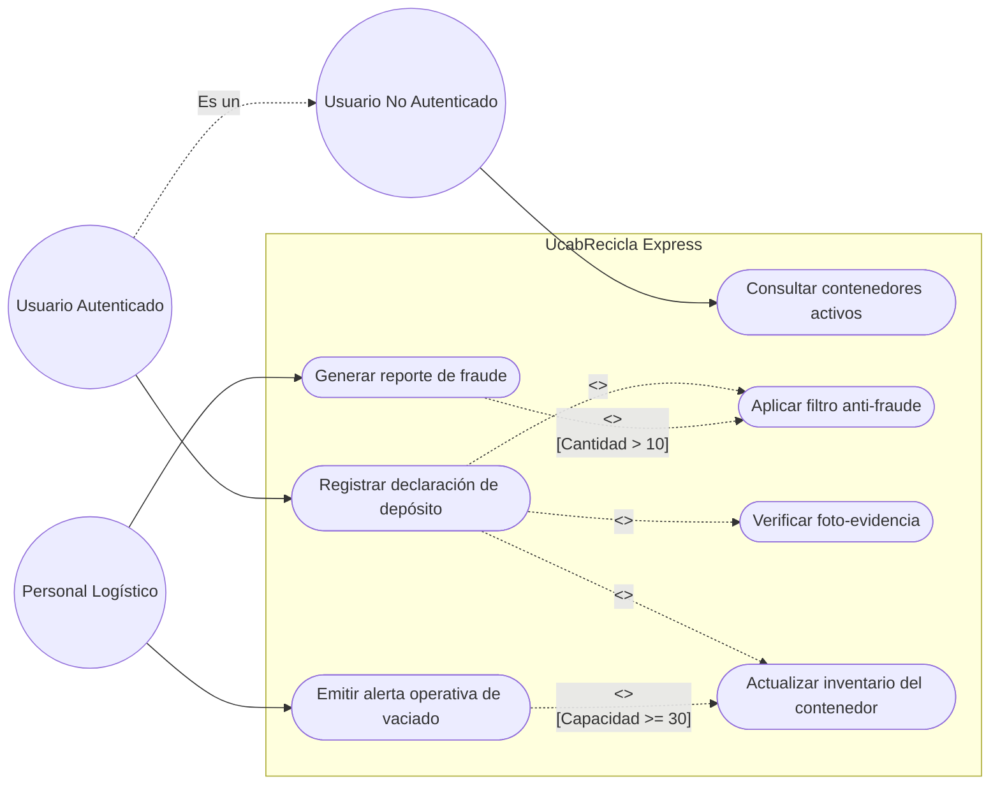
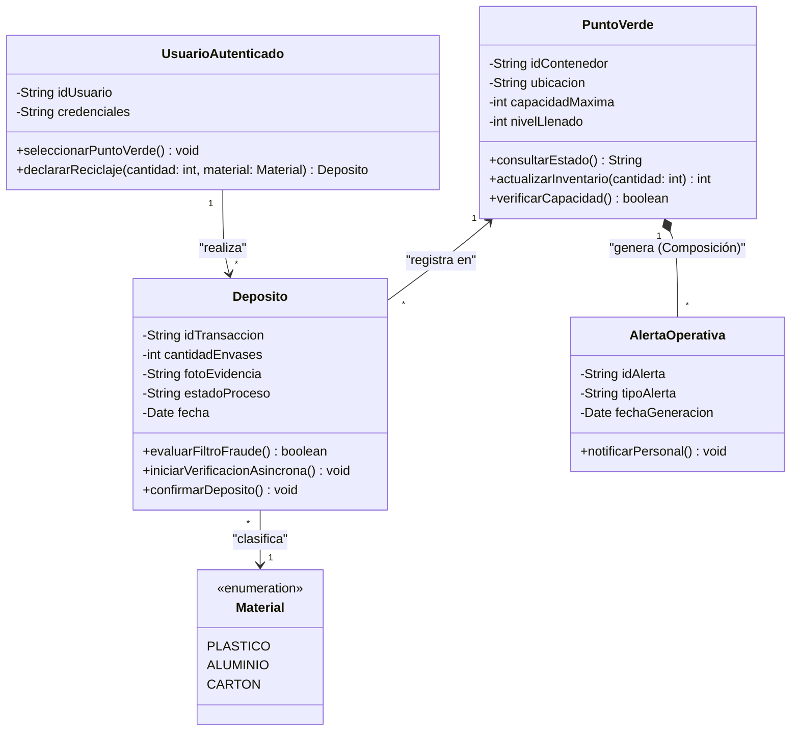
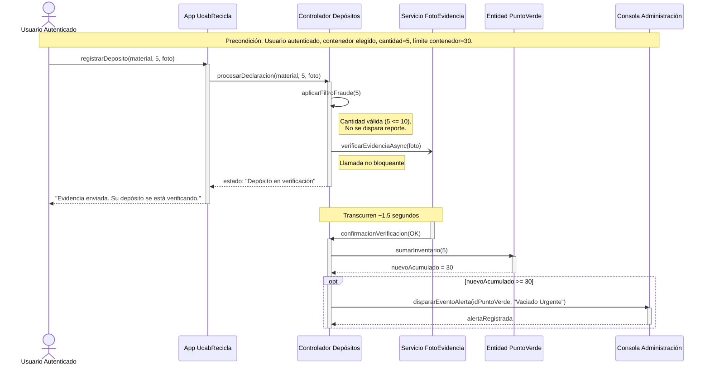
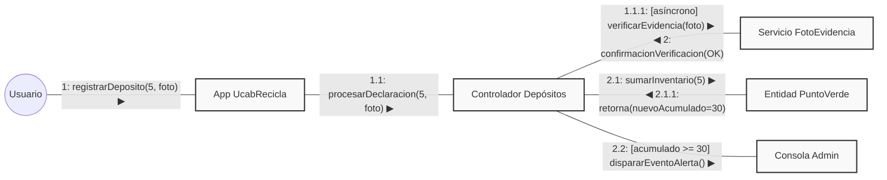

# Análisis del Caso de Estudio: UcabRecicla Express

### Análisis Inicial del Dominio

*   **Actores:** Usuario No Autenticado, Usuario Autenticado, Personal Logístico.
*   **Entidades:** `PuntoVerde` (Contenedor), `Deposito` (Orden de reciclaje), `Material` (Plástico, Aluminio, Cartón), `AlertaOperativa`, `Usuario`.
*   **Reglas de Negocio:**
    1.  Límite de prevención de fraude: máximo 10 envases por transacción. Si se supera, se aborta la operación y se registra un reporte sin modificar inventarios.
    2.  Verificación de evidencia asíncrona: toma aproximadamente 1,5 segundos y no bloquea la interfaz del usuario.
    3.  Límite de capacidad por contenedor: máximo 30 unidades. Si el inventario alcanza o supera este límite, se debe disparar una alerta crítica de vaciado.
*   **Ambigüedades detectadas:** El texto no especifica si el "Personal Logístico" recibe la alerta operativa a través de la app móvil, correo o solo se visualiza en la consola. 
*   **Supuestos adoptados:** 
    1.  Asumo que la "consola de administración" y la "consola de auditoría" son interfaces (o subsistemas) que forman parte de la misma frontera del sistema "UcabRecicla Express".
    2.  En el diagrama de clases, modelo `Material` como una enumeración (Enum).
    3.  Para el escenario de los diagramas de interacción, asumo que la cantidad depositada es válida (ej. 5 envases) y que, al sumarse, el contenedor alcanza exactamente su límite (30), para poder graficar la notificación de alerta.

---

### 1. Diagrama de Casos de Uso

---

### 2. Diagrama de Clases

---

### 3. Diagrama de Secuencia
*Escenario: Registrar Depósito con Validación Asíncrona y Notificación de Alerta por Llenado.*

---

### 4. Diagrama de Colaboración (Comunicación)
*Escenario: Registrar Depósito con Validación Asíncrona y Notificación de Alerta por Llenado.*

