<div class="portada">

# Taller UML y Validación Crítica con IA

<p><strong>Caso de estudio:</strong> UcabRecicla Express</p>
<p>Programación Orientada a Objetos<br>Docente: Jannelly Bello</p>

<p><strong>Integrantes</strong><br>
Alessandro Perez<br>
Jade Salazar<br>
Sebastian Rivas</p>

<p><strong>Herramienta de IA utilizada:</strong> Gemini &nbsp;·&nbsp; Renderizado: Mermaid Live</p>
<p>13 de noviembre de 2026</p>

</div>

<div class="page-break"></div>

## 2. Ambigüedades detectadas y supuestos adoptados

| # | Ambigüedad en el enunciado | Decisión / supuesto adoptado |
|---|---|---|
| 1 | No se dice quién puede autenticarse ni si estudiante, profesor y visitante se distinguen. | Los tres son especializaciones de `Usuario`; cualquiera puede consultar sin sesión y, una vez autenticado, declarar reciclaje. |
| 2 | No se aclara si un Punto Verde tiene uno o varios contenedores. | Un Punto Verde agrupa uno o más contenedores (uno por tipo de material) y estos no existen fuera de él (composición). |
| 3 | "Contenedores activos" no se define. | Activo = contenedor operativo y visible en el sistema. |
| 4 | El nivel de llenado se expresa "en relación con su capacidad total", pero la alerta habla de "30 unidades". | El nivel se mide en envases (unidades); el límite de alerta es 30 unidades acumuladas. |
| 5 | El límite de 10 envases: ¿10 es válido? | Solo se rechaza si la cantidad es **mayor** que 10; 10 es válido. |
| 6 | Se usan "declaración", "orden" y "depósito" como términos distintos. | Se tratan como el mismo objeto: la declaración genera la orden que, al validarse, se registra como depósito. |
| 7 | No se dice quién verifica la foto-evidencia. | Un componente de verificación del sistema, invocado de forma asíncrona (~1,5 s). |
| 8 | No se indica qué ocurre si la foto no es válida. | Queda fuera del escenario exitoso modelado. |
| 9 | La "consola de auditoría" y la "consola de administración" no se describen como actores. | Son interfaces del sistema; el actor que recibe la alerta es el **Personal Logístico**, considerado un usuario autenticado. |
| 10 | No se dice si el vaciado del contenedor se registra en el sistema. | El Personal Logístico atiende la alerta y registra el vaciado del contenedor. |
| 11 | No se aclara si cada Punto Verde acepta todos los materiales. | Cada Punto Verde tiene una lista de materiales permitidos (plástico, aluminio, cartón). |

<div class="page-break"></div>

## 3. Diagramas originales (Fase 1, sin IA)

### 3.1 Diagrama de casos de uso
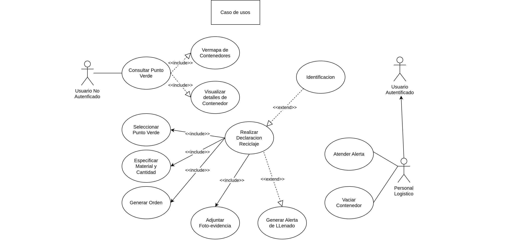

### 3.2 Diagrama de clases
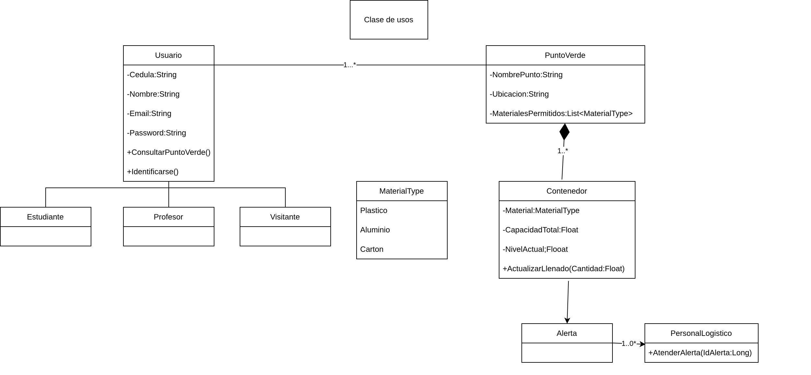

### 3.3 Diagrama de secuencia
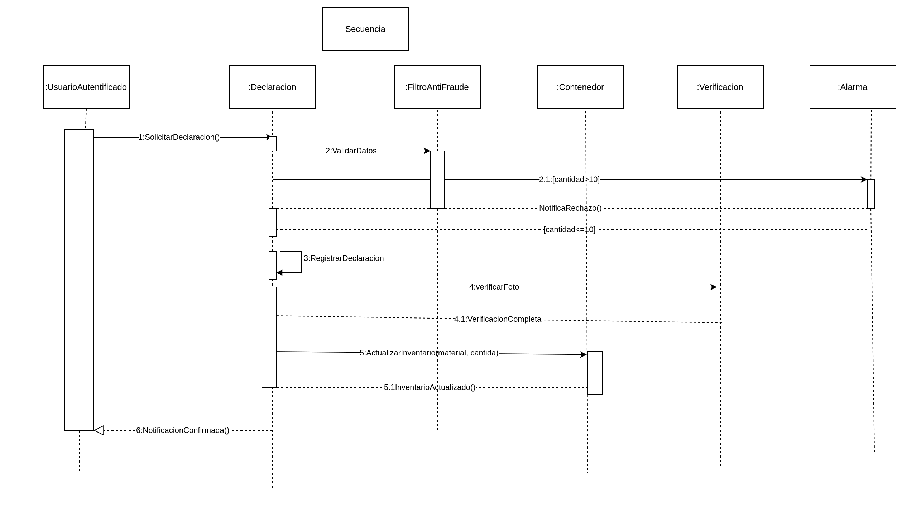

### 3.4 Diagrama de colaboración
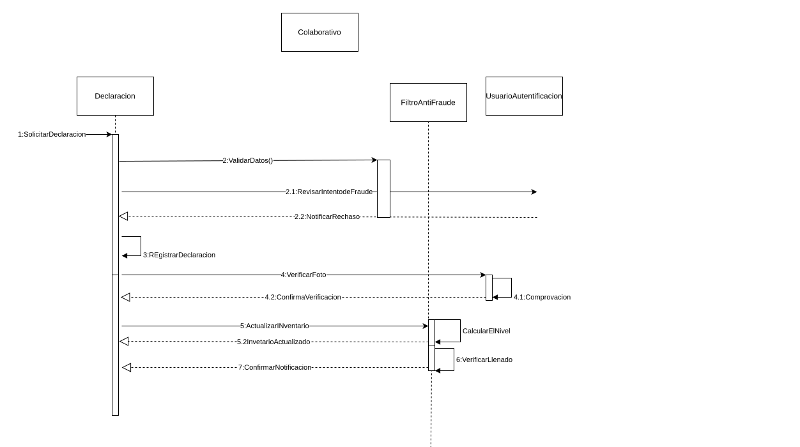

<div class="page-break"></div>

## 4. Prompt inicial y respuesta de la IA (v1)

### 4.1 Prompt inicial

~~~text
Actúa como analista de software experto en UML 2.5 y en la sintaxis de Mermaid (compatible con Mermaid Live Editor, https://mermaid.live).

A partir del siguiente caso de estudio, genera 4 diagramas UML en código Mermaid.

=== CASO DE ESTUDIO: UcabRecicla Express ===
La universidad requiere una aplicación móvil de gestión de depósitos inteligentes denominada UcabRecicla Express para auditar la integridad del proceso de reciclaje en el campus y optimizar el control operativo de los Puntos Verdes ubicados en áreas estratégicas como el Módulo de Aulas, la Feria Universitaria y el Edificio de Ingeniería.

Cualquier estudiante, profesor o visitante puede consultar, sin necesidad de iniciar sesión, la lista de contenedores activos en el sistema, visualizando el tipo de material que recibe cada uno (plástico, aluminio o cartón) y su nivel de llenado en tiempo real en relación con su capacidad total. Para realizar una declaración de reciclaje, el usuario autenticado debe seleccionar el Punto Verde de su preferencia, especificar el tipo de material e indicar la cantidad de envases a depositar. Durante la generación de la orden, el sistema aplica un filtro anti-fraude obligatorio que evalúa los datos de entrada antes de registrar el depósito; si el usuario declara una cantidad superior al límite permitido de 10 envases en una sola transacción, el sistema frena inmediatamente la operación, interrumpe el registro, emite un reporte de intento de fraude en la consola de auditoría y notifica el rechazo al usuario sin modificar los datos del sistema. Si la cantidad enviada cumple con las reglas de negocio, el servicio verifica la foto-evidencia (una foto de los envases depositados que el usuario adjunta a su declaración) de forma asíncrona: el usuario no queda bloqueado mientras espera y la verificación tarda unos 1,5 segundos en confirmarse. Transcurrido este tiempo y validado el depósito, se efectúa la actualización e incremento del inventario en el Punto Verde correspondiente. Finalmente, el sistema evalúa el nuevo acumulado del contenedor y, si este alcanza o supera su límite máximo de 30 unidades, dispara un evento de alerta operativa crítica en la consola de administración para notificar al personal logístico que el contenedor requiere un vaciado urgente.

Escenario para los diagramas de secuencia y de colaboración: Registrar Depósito con Validación Asíncrona y Notificación de Alerta por Llenado.
=== FIN DEL CASO ===

Diagramas requeridos:

1. Diagrama de casos de uso. Identifica los actores y representa los casos de uso que se desprenden del texto, dentro de la frontera del sistema. Incluye al menos una relación <<include>> y una <<extend>>. Mermaid no tiene un tipo nativo de casos de uso: usa `flowchart LR`, con un `subgraph` como frontera del sistema, los casos de uso como nodos ovalados `([...])` y las relaciones include/extend como flechas punteadas etiquetadas.

2. Diagrama de clases (`classDiagram`). Modela las entidades del dominio con sus atributos y métodos, e indica la visibilidad de cada miembro (+ público, - privado). Define la multiplicidad en ambos extremos de cada relación y aplica el tipo de relación que corresponda (asociación, composición, agregación y, si la identificas, generalización).

3. Diagrama de secuencia (`sequenceDiagram`) del flujo del escenario exitoso indicado. Decide qué participantes intervienen y cuáles son las precondiciones del escenario, y anótalas en el diagrama con `Note`. Representa los mensajes, sus retornos, las activaciones y los fragmentos de control que el escenario requiera.

4. Diagrama de colaboración (comunicación) de la misma interacción, con los mismos participantes. Mermaid no tiene un tipo nativo: usa `flowchart` con los objetos como nodos y un único enlace por cada par de objetos que se comunican. Numera explícitamente el orden cronológico de los mensajes sobre los enlaces, con numeración jerárquica cuando haya anidamiento (1, 1.1, 2…), coherente con el diagrama de secuencia.

Formato de la respuesta:
- Primero, una lista breve de: actores, entidades, reglas de negocio, ambigüedades detectadas en el texto y supuestos que adoptaste.
- Luego, cada diagrama en su propio bloque ```mermaid, precedido de su título.
- El código debe renderizar sin errores en la versión actual de Mermaid Live. Escribe entre comillas dobles las etiquetas que tengan caracteres especiales (<<, >>, :, paréntesis).
~~~

### 4.2 Respuesta de la IA (sin editar)

Respuesta de Gemini transcrita literalmente: primero el análisis del dominio y después el código de cada diagrama (apartados 4.3 a 4.6).

~~~text
# Análisis del Caso de Estudio: UcabRecicla Express

### Análisis Inicial del Dominio

*   **Actores:** Usuario No Autenticado, Usuario Autenticado, Personal Logístico.
*   **Entidades:** `PuntoVerde` (Contenedor), `Deposito` (Orden de reciclaje), `Material` (Plástico, Aluminio, Cartón), `AlertaOperativa`, `Usuario`.
*   **Reglas de Negocio:**
    1.  Límite de prevención de fraude: máximo 10 envases por transacción. Si se supera, se aborta la operación y se registra un reporte sin modificar inventarios.
    2.  Verificación de evidencia asíncrona: toma aproximadamente 1,5 segundos y no bloquea la interfaz del usuario.
    3.  Límite de capacidad por contenedor: máximo 30 unidades. Si el inventario alcanza o supera este límite, se debe disparar una alerta crítica de vaciado.
*   **Ambigüedades detectadas:** El texto no especifica si el "Personal Logístico" recibe la alerta operativa a través de la app móvil, correo o solo se visualiza en la consola. 
*   **Supuestos adoptados:** 
    1.  Asumo que la "consola de administración" y la "consola de auditoría" son interfaces (o subsistemas) que forman parte de la misma frontera del sistema "UcabRecicla Express".
    2.  En el diagrama de clases, modelo `Material` como una enumeración (Enum).
    3.  Para el escenario de los diagramas de interacción, asumo que la cantidad depositada es válida (ej. 5 envases) y que, al sumarse, el contenedor alcanza exactamente su límite (30), para poder graficar la notificación de alerta.
~~~

### 4.3 Casos de uso: código v1 y render

~~~text
flowchart LR
    %% Definición de Actores
    U((Usuario No Autenticado))
    UA((Usuario Autenticado))
    PL((Personal Logístico))
    
    UA -. "Es un" .-> U

    %% Frontera del sistema
    subgraph UcabRecicla Express
        UC1([Consultar contenedores activos])
        UC2([Registrar declaración de depósito])
        UC3([Aplicar filtro anti-fraude])
        UC4([Generar reporte de fraude])
        UC5([Verificar foto-evidencia])
        UC6([Actualizar inventario del contenedor])
        UC7([Emitir alerta operativa de vaciado])
    end

    %% Relaciones Actor - Caso de Uso
    U --> UC1
    UA --> UC2
    PL --> UC7
    PL --> UC4

    %% Relaciones Include y Extend
    UC2 -. "<<include>>" .-> UC3
    UC4 -. "<<extend>> <br> [Cantidad > 10]" .-> UC3
    
    UC2 -. "<<include>>" .-> UC5
    UC2 -. "<<include>>" .-> UC6
    
    UC7 -. "<<extend>> <br> [Capacidad >= 30]" .-> UC6
~~~

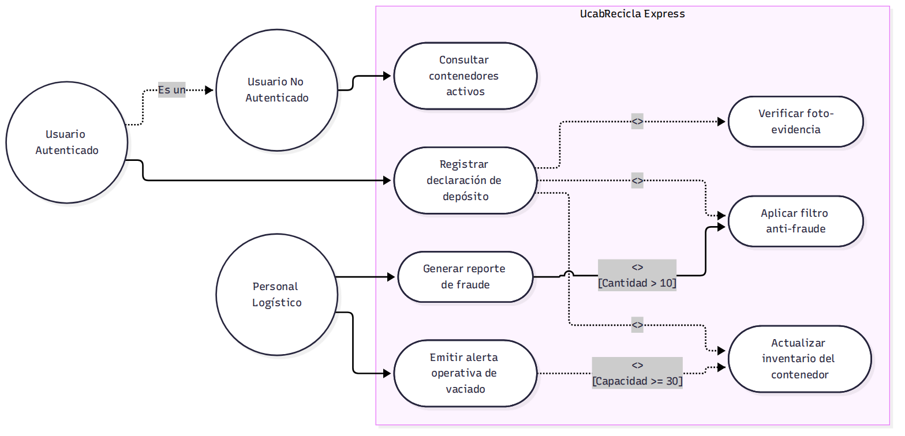

### 4.4 Clases: código v1 y render

~~~text
classDiagram
    class Material {
        <<enumeration>>
        PLASTICO
        ALUMINIO
        CARTON
    }

    class UsuarioAutenticado {
        -String idUsuario
        -String credenciales
        +seleccionarPuntoVerde() void
        +declararReciclaje(cantidad: int, material: Material) Deposito
    }

    class PuntoVerde {
        -String idContenedor
        -String ubicacion
        -int capacidadMaxima
        -int nivelLlenado
        +consultarEstado() String
        +actualizarInventario(cantidad: int) int
        +verificarCapacidad() boolean
    }

    class Deposito {
        -String idTransaccion
        -int cantidadEnvases
        -String fotoEvidencia
        -String estadoProceso
        -Date fecha
        +evaluarFiltroFraude() boolean
        +iniciarVerificacionAsincrona() void
        +confirmarDeposito() void
    }

    class AlertaOperativa {
        -String idAlerta
        -String tipoAlerta
        -Date fechaGeneracion
        +notificarPersonal() void
    }

    %% Relaciones y multiplicidad
    UsuarioAutenticado "1" --> "*" Deposito : "realiza"
    Deposito "*" --> "1" Material : "clasifica"
    PuntoVerde "1" <-- "*" Deposito : "registra en"
    PuntoVerde "1" *-- "*" AlertaOperativa : "genera (Composición)"
~~~

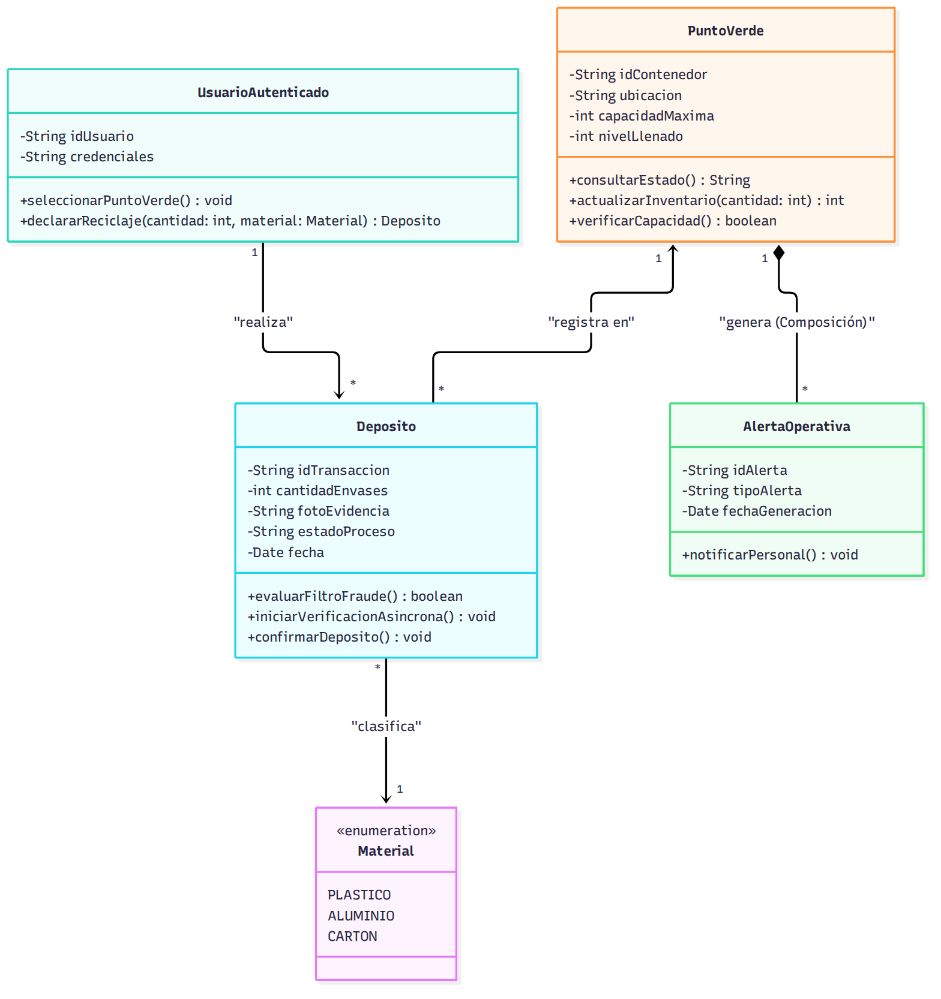

### 4.5 Secuencia: código v1 y render

~~~text
sequenceDiagram
    actor UA as Usuario Autenticado
    participant APP as App UcabRecicla
    participant CTRL as Controlador Depósitos
    participant VF as Servicio FotoEvidencia
    participant PV as Entidad PuntoVerde
    participant CONS as Consola Administración

    Note over UA, CONS: Precondición: Usuario autenticado, contenedor elegido, cantidad=5, límite contenedor=30.

    UA->>APP: registrarDeposito(material, 5, foto)
    activate APP
    
    APP->>CTRL: procesarDeclaracion(material, 5, foto)
    activate CTRL
    
    %% Filtro Anti-Fraude (Síncrono)
    CTRL->>CTRL: aplicarFiltroFraude(5)
    Note right of CTRL: Cantidad válida (5 <= 10).<br>No se dispara reporte.
    
    %% Llamada Asíncrona
    CTRL-)VF: verificarEvidenciaAsync(foto)
    Note right of CTRL: Llamada no bloqueante
    
    CTRL-->>APP: estado: "Depósito en verificación"
    deactivate CTRL
    APP-->>UA: "Evidencia enviada. Su depósito se está verificando."
    deactivate APP

    %% Retorno Asíncrono después de 1.5s
    Note over VF, CTRL: Transcurren ~1,5 segundos
    activate VF
    VF->>CTRL: confirmacionVerificacion(OK)
    deactivate VF
    activate CTRL
    
    %% Actualización de inventario
    CTRL->>PV: sumarInventario(5)
    activate PV
    PV-->>CTRL: nuevoAcumulado = 30
    deactivate PV
    
    %% Fragmento de control (Alerta)
    opt nuevoAcumulado >= 30
        CTRL->>CONS: dispararEventoAlerta(idPuntoVerde, "Vaciado Urgente")
        activate CONS
        CONS-->>CTRL: alertaRegistrada
        deactivate CONS
    end
    
    deactivate CTRL
~~~

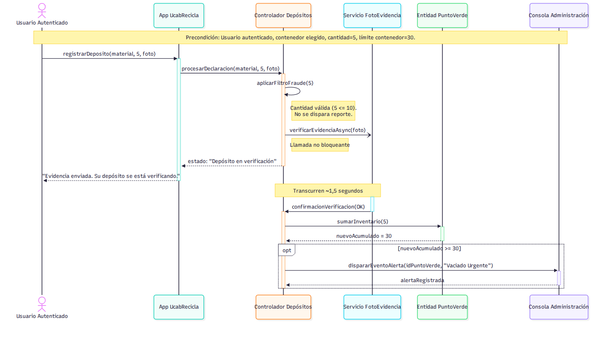

### 4.6 Colaboración: código v1 y render

~~~text
flowchart LR
    %% Nodos (Objetos / Participantes)
    UA((Usuario))
    APP[App UcabRecicla]
    CTRL[Controlador Depósitos]
    VF[Servicio FotoEvidencia]
    PV[Entidad PuntoVerde]
    CONS[Consola Admin]

    %% Enlaces únicos por cada par con direccionalidad simulada en los labels y numeración jerárquica
    UA -- "1: registrarDeposito(5, foto) ▶" --- APP
    
    APP -- "1.1: procesarDeclaracion(5, foto) ▶" --- CTRL
    
    %% El Controlador interactúa con los 3 subsistemas
    CTRL -- "1.1.1: [asíncrono] verificarEvidencia(foto) ▶ <br> ◀ 2: confirmacionVerificacion(OK)" --- VF
    
    CTRL -- "2.1: sumarInventario(5) ▶ <br> ◀ 2.1.1: retorna(nuevoAcumulado=30)" --- PV
    
    CTRL -- "2.2: [acumulado >= 30] dispararEventoAlerta() ▶" --- CONS

    %% Estilos para semejar un entorno UML
    classDef object fill:#f9f9f9,stroke:#333,stroke-width:2px;
    class APP,CTRL,VF,PV,CONS object;
~~~

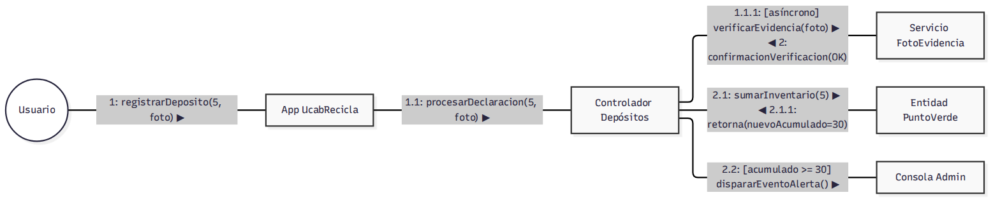

<div class="page-break"></div>

## 5. Matriz de análisis comparativo

Clasificación: **S** = sintáctico (no renderiza / notación inválida), **Sem** = semántico (renderiza pero modela mal). Gravedad: **A** alta, **M** media, **B** baja.

| Diagrama | Errores de la IA (tipo y gravedad) | Errores propios detectados | Resultado tras corrección |
|---|---|---|---|
| **Casos de uso** | No confundió «include» con «extend» (en el código, ambos van en la dirección correcta) y no faltó ningún actor.<br>• **CU-1 · S · A** — Las etiquetas `"<<include>>"` / `"<<extend>>"` se renderizan como `<>`: en la imagen no se distingue include de extend.<br>• **CU-2 · S · B** — La generalización *Usuario Autenticado → Usuario No Autenticado* está dibujada como flecha punteada con el texto "Es un", igual que una dependencia.<br>• **CU-3 · S · B** — Las asociaciones actor–caso de uso tienen punta de flecha (`-->`) en vez de ser una línea simple.<br>• **CU-4 · Sem · M** — *Personal Logístico* está asociado a *Generar reporte de fraude*, pero ese reporte va a la consola de auditoría.<br>• **CU-5 · Sem · B** — *Aplicar filtro anti-fraude* y *Actualizar inventario* son pasos internos del sistema modelados como casos de uso (descomposición funcional).<br>• **CU-6 · Sem · B** — La condición del «extend» dice `[Capacidad >= 30]`, pero lo que se compara es el acumulado. | • No dibujamos la **frontera del sistema** (requisito explícito).<br>• «Identificación» como «extend» de *Realizar Declaración*: autenticarse es obligatorio (precondición o «include»), no opcional.<br>• La flecha «extend» hacia *Generar Alerta de Llenado* está invertida: debe ir de la alerta al caso base.<br>• Notación de «include» inconsistente: línea continua con punta rellena y, en *Consultar Punto Verde*, punta triangular hueca (de generalización); debe ser línea punteada con punta abierta.<br>• *Usuario Autenticado* no está asociado a ningún caso de uso y *Realizar Declaración* no tiene actor.<br>• Falta la generalización *Usuario Autenticado → Usuario No Autenticado*; la de *Personal Logístico* usa punta abierta en vez de triángulo hueco.<br>• No modelamos el rechazo / reporte de intento de fraude.<br>• Erratas: "Autenficado", "Vermapa", "LLenado".<br>**La IA lo hizo mejor en:** frontera del sistema, generalización entre actores, fraude como «extend» con condición. | **Iteración 1:** corrigió CU-1, CU-3, CU-4, CU-5 y CU-6. CU-2 quedó a medias: la generalización ya se distingue, pero tiene punta rellena y la etiqueta «generalization».<br>**Iteración 2:** la etiqueta ya dice "generalización". La punta rellena persiste porque el `flowchart` de Mermaid no tiene triángulo hueco (limitación de la herramienta).<br>**Iteración 3:** no se envió (sin errores de modelado pendientes).<br>**Limitación final:** CU-2, la punta de la generalización (Mermaid no tiene triángulo hueco en `flowchart`). |
| **Clases** | No omitió visibilidad ni multiplicidades: están completas en todos los miembros y relaciones.<br>• **CL-1 · Sem · A** — Falta la clase *Contenedor*: *PuntoVerde* absorbe sus datos (`idContenedor`, `nivelLlenado`, `capacidadMaxima`) y se pierde el tipo de material de cada contenedor.<br>• **CL-2 · Sem · M** — No hay clases *Usuario* (no autenticado) ni *PersonalLogistico*, aunque son actores y `notificarPersonal()` los necesita.<br>• **CL-3 · Sem · M** — Falta *ReporteFraude* y el límite de 10 envases no aparece en el modelo.<br>• **CL-4 · Sem · B** — Inventó atributos: `credenciales`, `estadoProceso`, `fecha`, `tipoAlerta` y `fechaGeneracion`.<br>• **CL-5 · Sem · B** — *PuntoVerde* ◆ *AlertaOperativa* es composición, pero la alerta es un evento, no una parte; corresponde una asociación.<br>• **CL-6 · S · B** — Las etiquetas muestran comillas literales y los atributos usan estilo Java (`-String idUsuario`), distinto del de los métodos. | • Falta la clase central **Declaración/Depósito** (cantidad, material, foto, punto verde), y también *FotoEvidencia* y *ReporteFraude*; la secuencia usa `:Declaracion`, `:FiltroAntiFraude`, `:Verificacion` y `:Alarma`, que no existen en las clases.<br>• Asociación *Usuario–PuntoVerde* con multiplicidad en un solo extremo y notación inválida ("1...*").<br>• Composición *PuntoVerde–Contenedor* sin multiplicidad del lado del todo (1); además *Contenedor→Alerta* sin multiplicidades y "1..0*" no es válida.<br>• La generalización *Usuario → Estudiante/Profesor/Visitante* no tiene triángulo hueco.<br>• *MaterialType* sin el estereotipo «enumeration».<br>• *PersonalLogistico* no hereda de *Usuario* (incoherente con los casos de uso); *Alerta* sin atributos ni métodos.<br>• Agregamos atributos no derivados del caso (Cédula, Email, Password) sin documentarlos; faltan los límites 10 y 30.<br>• Errata "-NivelActual;Flooat"; el nivel y la capacidad cuentan envases (enteros), no Float.<br>**La IA lo hizo mejor en:** la clase *Deposito* como entidad central, el «enumeration» *Material*, las multiplicidades en ambos extremos y los tipos `int`. | **Iteración 1:** corrigió CL-1 a CL-6. Introdujo CL-7 (faltan las relaciones Controlador–Contenedor y Consola–Alerta), CL-8 (relaciones nuevas sin multiplicidad) y CL-9 (*Deposito* genera *ReporteFraude*).<br>**Iteración 2:** corrigió CL-7, CL-8 y CL-9. Queda CL-10 (navegabilidad invertida en Contenedor–AlertaOperativa).<br>**Iteración 3:** corrigió CL-10.<br>**Final:** sin errores pendientes. |
| **Secuencia** | No faltan retornos ni el retardo asíncrono ni la alerta: usa `-)`, una nota de ~1,5 s y `opt [nuevoAcumulado >= 30]`.<br>• **SEC-1 · Sem · A** — No es coherente con el diagrama de clases: *App*, *Controlador*, *Servicio FotoEvidencia* y *Consola* no son clases del modelo; *Deposito* y *AlertaOperativa* no participan; los métodos tienen otros nombres; y el depósito nunca se crea ni se confirma.<br>• **SEC-2 · Sem · M** — Los mensajes no están numerados, así que no se puede comprobar la coherencia con la colaboración.<br>• **SEC-3 · Sem · M** — `confirmacionVerificacion(OK)` es síncrono (`->>`) aunque es la respuesta de una llamada asíncrona, y el servicio solo se activa después de la nota de 1,5 s.<br>• **SEC-4 · Sem · B** — La precondición mezcla datos de entrada y reglas, y omite el acumulado previo de 25.<br>• **SEC-5 · Sem · B** — La alerta termina en la consola y nunca llega al *Personal Logístico*. | • **No modelamos la alerta por llenado** (`opt [acumulado ≥ 30]` → consola de administración / Personal Logístico): falta la mitad del escenario.<br>• `4:verificarFoto` se dibujó como síncrono; no hay asincronía ni retardo de 1,5 s.<br>• No usamos fragmentos combinados (`alt`/`opt`): la rama de fraude aparece como mensajes sueltos con guardas, en un escenario que debía ser el exitoso.<br>• El reporte de fraude se envía a `:Alarma` (que es la alerta de llenado) y no a la consola de auditoría; el retorno `[cantidad<=10]` sale de `:Alarma` en vez del filtro.<br>• Falta el retorno de `2:ValidarDatos`.<br>• `6:NotificacionConfirmada` usa punta de generalización.<br>• No anotamos las precondiciones.<br>• Errata "cantida".<br>**La IA lo hizo mejor en:** verificación asíncrona (`-)`), retardo de 1,5 s, `opt` de alerta, precondición anotada y devolución del control al usuario antes de verificar. | **Iteración 1:** corrigió SEC-2 a SEC-5. SEC-1 quedó a medias (mensajes que no son operaciones del receptor). Introdujo SEC-6 (el *Deposito* se crea antes del filtro), SEC-7 (`[[…]]`) y retornos numerados.<br>**Iteración 2:** corrigió SEC-1, SEC-6 y SEC-7, y quitó la numeración de los retornos. Queda SEC-8 (las creaciones no usan «create» ni empiezan la línea de vida).<br>**Iteración 3:** corrigió SEC-8 (`create participant` + «create»).<br>**Final:** sin errores pendientes. |
| **Colaboración** | Sí numeró sobre los enlaces, en orden cronológico y con jerarquía (1, 1.1, 1.1.1, 2, 2.1, 2.2).<br>• **COL-1 · Sem · A** — No es la misma interacción que la secuencia: faltan la autollamada `aplicarFiltroFraude(5)`, el retorno "Depósito en verificación" y la respuesta al usuario.<br>• **COL-2 · Sem · M** — `2.1.1: retorna(nuevoAcumulado=30)` numera un retorno como si fuera un mensaje nuevo anidado.<br>• **COL-3 · Sem · B** — `[asíncrono]` va entre corchetes, que es notación de guarda.<br>• **COL-4 · Sem · B** — Los objetos no usan la forma `:Clase` y sus nombres no coinciden con la secuencia. | • Lo dibujamos como **otro diagrama de secuencia** (líneas de vida y activaciones), no como colaboración (objetos unidos por enlaces con los mensajes numerados encima).<br>• No tiene los mismos participantes: faltan `:Contenedor`, `:Verificacion` y `:Alarma`, y aparece "UsuarioAutentificacion".<br>• La numeración no coincide con la secuencia (2.1, 4.1/4.2, 5.2, 6 y 7 difieren; "CalcularElNivel" no tiene número).<br>• Receptores equivocados: `5:ActualizarInventario` va al filtro y `4:VerificarFoto` al usuario.<br>• No aparece la alerta de llenado.<br>**La IA lo hizo mejor en:** es un diagrama de comunicación real, con un enlace por par de objetos y numeración jerárquica. | **Iteración 1:** corrigió COL-1, COL-3 y COL-4. COL-2 persiste: ahora numera los retornos 1.1.4 y 1.2. Introdujo COL-5 (argumentos distintos a los de la secuencia).<br>**Iteración 2:** corrigió COL-2 y COL-5. La numeración coincide al 100 % con la secuencia.<br>**Iteración 3:** marcó «create» en 1.1.2 y 2.3.1, igual que en la secuencia.<br>**Final:** sin errores pendientes; la numeración coincide al 100 % con la secuencia. |

<div class="page-break"></div>

## 6. Prompts de corrección e iteraciones

### Iteración 1

**Prompt enviado:**

~~~text
Revisé los 4 diagramas que generaste contra el caso y contra la notación UML 2.5. Encontré los errores listados abajo, cada uno con su ubicación. Corrígelos todos.

Restricciones:
- No modifiques lo que ya está correcto.
- No agregues actores, clases, atributos ni mensajes que no se deriven del caso.
- Usa los mismos participantes, nombres de métodos y numeración de mensajes en la secuencia y en la colaboración, y que esos participantes y métodos existan en el diagrama de clases.
- El código debe renderizar sin errores en la versión actual de Mermaid Live.

Errores en el diagrama de casos de uso:
CU-1. En las 5 relaciones include/extend (por ejemplo, UC2 -. "<<include>>" .-> UC3), Mermaid Live muestra la etiqueta como "<>" porque interpreta <<include>> como una etiqueta HTML: en el render no se distingue include de extend. Usa «include» / «extend» (comillas angulares) o &lt;&lt;include&gt;&gt;.
CU-2. En UA -. "Es un" .-> U, la generalización entre actores está dibujada como flecha punteada con el texto "Es un", igual que un include/extend. Debe verse como generalización (línea continua, etiquetada como generalización) y distinguirse de las dependencias.
CU-3. Las asociaciones actor–caso de uso (U --> UC1, UA --> UC2, PL --> UC7, PL --> UC4) tienen punta de flecha; en UML la asociación entre actor y caso de uso es una línea sin punta (---).
CU-4. En PL --> UC4, Personal Logístico está asociado a "Generar reporte de fraude". Según el caso, el reporte de fraude se emite en la consola de auditoría y el Personal Logístico solo recibe la alerta de vaciado. Elimina esa asociación.
CU-5. "Aplicar filtro anti-fraude" (UC3) y "Actualizar inventario del contenedor" (UC6) son pasos internos del sistema, no objetivos de un actor (descomposición funcional). Haz que "Generar reporte de fraude" extienda directamente a "Registrar declaración de depósito" con la condición [cantidad > 10], y que "Emitir alerta operativa de vaciado" extienda a ese mismo caso con [acumulado >= 30]. Conserva "Verificar foto-evidencia" como «include».
CU-6. En UC7 -. "<<extend>> <br> [Capacidad >= 30]" .-> UC6, la condición compara la capacidad; lo que se evalúa es el acumulado (nivel de llenado) del contenedor: [acumulado >= 30].

Errores en el diagrama de clases:
CL-1. No existe la clase Contenedor: PuntoVerde tiene idContenedor, capacidadMaxima y nivelLlenado, y se pierde el tipo de material que recibe cada contenedor. Separa PuntoVerde (nombre, ubicación) de Contenedor (material: Material, capacidadMaxima, nivelLlenado, actualizarInventario, verificarCapacidad), con composición PuntoVerde "1" *-- "1..*" Contenedor. El depósito se registra en un Contenedor.
CL-2. Faltan las clases de los actores del diagrama de casos de uso: no existen Usuario (no autenticado) ni PersonalLogistico, aunque AlertaOperativa.notificarPersonal() notifica al personal logístico. Agrega la generalización Usuario <|-- UsuarioAutenticado, la clase PersonalLogistico y su asociación con AlertaOperativa, con multiplicidades.
CL-3. El caso exige emitir un reporte de intento de fraude en la consola de auditoría, pero no hay una clase ReporteFraude, y el límite de 10 envases no aparece en ninguna parte del modelo (evaluarFiltroFraude() no recibe la cantidad ni hay constante). Agrégalos.
CL-4. Inventaste atributos que el caso no menciona: credenciales, estadoProceso y fecha en Deposito, y tipoAlerta y fechaGeneracion en AlertaOperativa. Elimínalos (puedes mantener los identificadores).
CL-5. PuntoVerde "1" *-- "*" AlertaOperativa es una composición, pero la alerta es un evento que emite el contenedor al llenarse, no una parte suya. Debe ser una asociación Contenedor "1" --> "0..*" AlertaOperativa. Quita también el texto "(Composición)" de la etiqueta.
CL-6. Las etiquetas de las relaciones (: "realiza", : "clasifica"…) se muestran con las comillas literales en el render: quítalas. Además, los atributos usan estilo Java (-String idUsuario) y los métodos estilo UML (cantidad: int). Unifica con la notación UML: -idUsuario: String.

Errores en el diagrama de secuencia:
SEC-1. No es coherente con el diagrama de clases: App UcabRecicla, Controlador Depósitos, Servicio FotoEvidencia y Consola Administración no existen como clases, y Deposito y AlertaOperativa, que sí existen, no participan. Los métodos también tienen otros nombres (sumarInventario frente a actualizarInventario; aplicarFiltroFraude frente a evaluarFiltroFraude). Además, el depósito nunca se crea ni se confirma (confirmarDeposito). Haz que los participantes y mensajes correspondan a clases y métodos del diagrama de clases, agregando a ese diagrama las clases de control o servicio que necesites.
SEC-2. Los mensajes no están numerados, así que no se puede comprobar que coincidan con la colaboración. Numera explícitamente cada mensaje con la misma numeración jerárquica que el diagrama de colaboración.
SEC-3. VF->>CTRL: confirmacionVerificacion(OK) usa ->> (síncrono), pero es la respuesta de una llamada asíncrona: usa -). Además, "activate VF" está después de la nota de 1,5 s; el servicio debe activarse al recibir verificarEvidenciaAsync y permanecer activo durante la verificación.
SEC-4. La nota de precondición mezcla datos de entrada (cantidad=5) y reglas (límite contenedor=30), y no dice que el contenedor ya tenía 25 unidades, que es lo que hace que nuevoAcumulado = 30. Las precondiciones deben ser estados previos: usuario autenticado, punto verde y contenedor activos, foto adjunta y acumulado previo del contenedor = 25.
SEC-5. Dentro del opt [nuevoAcumulado >= 30], la alerta termina en la Consola Administración y nunca llega al Personal Logístico, que el caso exige notificar. Agrega esa notificación.

Errores en el diagrama de colaboración:
COL-1. No es la misma interacción que la secuencia: faltan la autollamada aplicarFiltroFraude(5) del controlador (enlace reflexivo), el retorno estado "Depósito en verificación" a la App y el mensaje de la App al usuario. Agrégalos con la numeración de la secuencia.
COL-2. En el enlace CTRL—PV, "2.1.1: retorna(nuevoAcumulado=30)" numera un retorno como si PuntoVerde enviara un mensaje nuevo anidado en 2.1. Representa el valor de retorno dentro del propio mensaje 2.1 (por ejemplo, 2.1: nuevoAcumulado := actualizarInventario(5)).
COL-3. En "1.1.1: [asíncrono] verificarEvidencia(foto)", los corchetes son notación de guarda (condición). Indica la asincronía de otra forma (por ejemplo, con «asíncrono» o una nota), sin corchetes.
COL-4. Los nombres de los objetos no siguen la notación de instancia :Clase y no coinciden con la secuencia (Usuario frente a Usuario Autenticado; Consola Admin frente a Consola Administración). Usa exactamente los mismos participantes con la forma :Clase.

Responde con el código completo y corregido de los 4 diagramas, cada uno en su propio bloque ```mermaid, y al final una lista que indique, para cada ID (CU-1 … COL-4), qué cambiaste.
~~~

**Respuesta de la IA (sin editar), con el render de cada diagrama:**

~~~text
# Análisis del Caso de Estudio: UcabRecicla Express (Versión Corregida)

A continuación se presentan los diagramas UML corregidos, garantizando la consistencia entre ellos y el cumplimiento de la notación UML 2.5 y la sintaxis de Mermaid.

### 1. Diagrama de Casos de Uso
~~~

~~~text
flowchart LR
    %% Actores
    U((Usuario No Autenticado))
    UA((Usuario Autenticado))
    PL((Personal Logístico))
    
    %% Generalización entre actores (Línea continua con etiqueta que la distingue)
    UA -- "«generalization»" --> U

    %% Frontera del sistema
    subgraph Frontera [UcabRecicla Express]
        UC1([Consultar contenedores activos])
        UC2([Registrar declaración de depósito])
        UC4([Generar reporte de fraude])
        UC5([Verificar foto-evidencia])
        UC7([Emitir alerta operativa de vaciado])
    end

    %% Asociaciones Actor - Caso de Uso (Líneas sin punta)
    U --- UC1
    UA --- UC2
    PL --- UC7

    %% Relaciones Include y Extend (usando comillas angulares y yendo hacia el caso base)
    UC2 -. "«include»" .-> UC5
    UC4 -. "«extend» <br> [cantidad > 10]" .-> UC2
    UC7 -. "«extend» <br> [acumulado >= 30]" .-> UC2
~~~

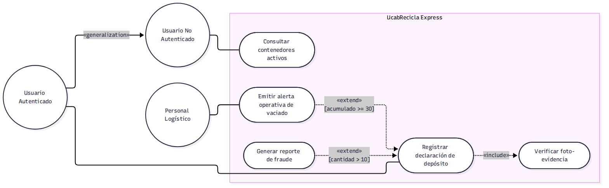

~~~text
### 2. Diagrama de Clases
~~~

~~~text
classDiagram
    class Material {
        <<enumeration>>
        PLASTICO
        ALUMINIO
        CARTON
    }

    class Usuario {
        -idUsuario: String
        +consultarContenedores() void
    }

    class UsuarioAutenticado {
        +seleccionarPuntoVerde() void
        +registrarDeposito(cantidad: int, material: Material, foto: String) void
    }
    Usuario <|-- UsuarioAutenticado

    class PersonalLogistico {
        -idPersonal: String
        +recibirNotificacionVaciado() void
    }

    class PuntoVerde {
        -idPuntoVerde: String
        -ubicacion: String
    }

    class Contenedor {
        -idContenedor: String
        -material: Material
        -capacidadMaxima: int = 30
        -nivelLlenado: int
        +actualizarInventario(cantidad: int) int
        +verificarCapacidad() boolean
    }

    class Deposito {
        -idTransaccion: String
        -cantidadEnvases: int
        -fotoEvidencia: String
        +confirmarDeposito() void
    }

    class ReporteFraude {
        -idReporte: String
    }

    class AlertaOperativa {
        -idAlerta: String
        +notificarPersonal() void
    }

    class AppUcabRecicla {
        +registrarDeposito(cantidad: int, material: Material, foto: String) void
    }

    class ControladorDepositos {
        -MAX_ENVASES_FRAUDE: int = 10
        +procesarDeclaracion(cantidad: int, material: Material, foto: String) void
        +evaluarFiltroFraude(cantidad: int) boolean
    }

    class ServicioFotoEvidencia {
        +verificarEvidenciaAsync(foto: String) void
    }

    class ConsolaAdministracion {
        +dispararEventoAlerta(idContenedor: String, mensaje: String) void
    }

    %% Relaciones
    PuntoVerde "1" *-- "1..*" Contenedor : contiene
    Contenedor "1" <-- "*" Deposito : se registra en
    Contenedor "1" --> "0..*" AlertaOperativa : genera
    AlertaOperativa "*" --> "1" PersonalLogistico : notifica a
    Deposito "1" --> "0..1" ReporteFraude : genera
    Deposito "*" --> "1" Material : clasifica
    UsuarioAutenticado "1" --> "*" Deposito : realiza
    
    %% Dependencias de arquitectura (agregadas por consistencia con interacción)
    AppUcabRecicla --> ControladorDepositos : invoca
    ControladorDepositos --> Deposito : crea y gestiona
    ControladorDepositos --> ServicioFotoEvidencia : solicita validación
    ControladorDepositos --> ConsolaAdministracion : alerta a
~~~

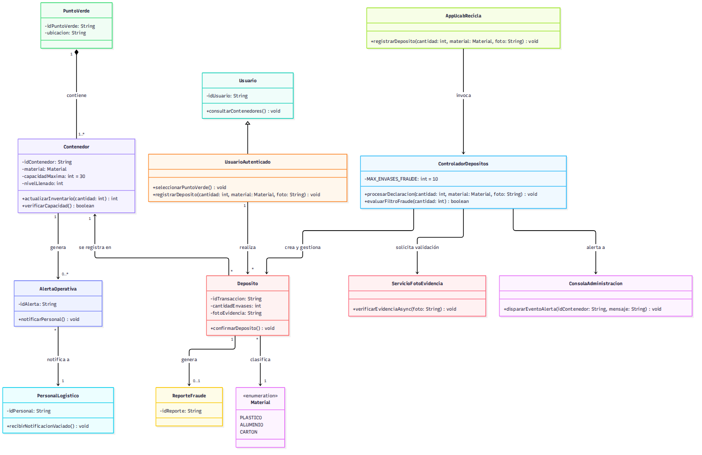

~~~text
### 3. Diagrama de Secuencia
~~~

~~~text
sequenceDiagram
    actor UA as :UsuarioAutenticado
    participant APP as :AppUcabRecicla
    participant CTRL as :ControladorDepositos
    participant DEP as :Deposito
    participant VF as :ServicioFotoEvidencia
    participant CONT as :Contenedor
    participant CONS as :ConsolaAdministracion
    participant ALERT as :AlertaOperativa
    actor PL as :PersonalLogistico

    Note over UA, PL: Precondición: usuario autenticado, punto verde y contenedor activos, foto adjunta y acumulado previo del contenedor = 25.

    UA->>APP: 1: registrarDeposito(5, material, foto)
    activate APP
    
    APP->>CTRL: 1.1: procesarDeclaracion(5, material, foto)
    activate CTRL
    
    CTRL->>DEP: 1.1.1: crear()
    activate DEP
    DEP-->>CTRL: (creado)
    deactivate DEP
    
    %% Autollamada - Filtro Anti-Fraude
    CTRL->>CTRL: 1.1.2: evaluarFiltroFraude(5)
    Note right of CTRL: Cantidad válida (5 <= 10).
    
    %% Llamada Asíncrona
    CTRL-)VF: 1.1.3: «asíncrono» verificarEvidenciaAsync(foto)
    activate VF
    Note right of CTRL: Llamada no bloqueante
    
    %% Retornos de estado
    CTRL-->>APP: 1.1.4: estado := "Depósito en verificación"
    deactivate CTRL
    APP-->>UA: 1.2: "Evidencia enviada. Su depósito se está verificando."
    deactivate APP

    Note over VF, CTRL: Transcurren ~1,5 segundos
    
    %% Retorno Asíncrono
    VF-)CTRL: 2: «asíncrono» confirmacionVerificacion(OK)
    deactivate VF
    activate CTRL
    
    CTRL->>DEP: 2.1: confirmarDeposito()
    activate DEP
    DEP-->>CTRL: (confirmado)
    deactivate DEP
    
    CTRL->>CONT: 2.2: nuevoAcumulado := actualizarInventario(5)
    activate CONT
    CONT-->>CTRL: (retorna 30)
    deactivate CONT
    
    %% Fragmento de control (Alerta)
    opt [nuevoAcumulado >= 30]
        CTRL->>CONS: 2.3: dispararEventoAlerta(idContenedor, "Vaciado Urgente")
        activate CONS
        
        CONS->>ALERT: 2.3.1: crear()
        activate ALERT
        
        ALERT->>PL: 2.3.2: notificarPersonal()
        activate PL
        PL-->>ALERT: (notificado)
        deactivate PL
        
        ALERT-->>CONS: (creada)
        deactivate ALERT
        
        CONS-->>CTRL: (alertaRegistrada)
        deactivate CONS
    end
    
    deactivate CTRL
~~~

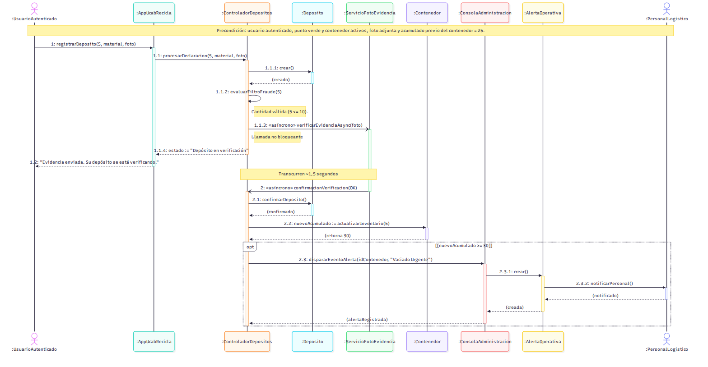

~~~text
### 4. Diagrama de Colaboración (Comunicación)
~~~

~~~text
flowchart LR
    %% Nodos con notación de instancia :Clase
    UA((:UsuarioAutenticado))
    APP[:AppUcabRecicla]
    CTRL[:ControladorDepositos]
    DEP[:Deposito]
    VF[:ServicioFotoEvidencia]
    CONT[:Contenedor]
    CONS[:ConsolaAdministracion]
    ALERT[:AlertaOperativa]
    PL((:PersonalLogistico))

    %% Enlaces
    UA -- "1: registrarDeposito(5, material, foto) ▶<br>◀ 1.2: estado := Depósito en verificación" --- APP
    
    APP -- "1.1: procesarDeclaracion(5, material, foto) ▶<br>◀ 1.1.4: estado := Depósito en verificación" --- CTRL
    
    CTRL -- "1.1.1: crear() ▶<br>2.1: confirmarDeposito() ▶" --- DEP
    
    CTRL -- "1.1.2: evaluarFiltroFraude(5) ↺" --- CTRL
    
    CTRL -- "1.1.3: «asíncrono» verificarEvidenciaAsync(foto) ▶<br>◀ 2: «asíncrono» confirmacionVerificacion(OK)" --- VF
    
    CTRL -- "2.2: nuevoAcumulado := actualizarInventario(5) ▶" --- CONT
    
    CTRL -- "2.3: [nuevoAcumulado >= 30] dispararEventoAlerta(idContenedor, 'Vaciado') ▶" --- CONS
    
    CONS -- "2.3.1: crear() ▶" --- ALERT
    
    ALERT -- "2.3.2: notificarPersonal() ▶" --- PL

    %% Estilos
    classDef object fill:#f9f9f9,stroke:#333,stroke-width:2px;
    class APP,CTRL,DEP,VF,CONT,CONS,ALERT object;
~~~

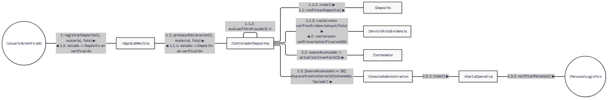

~~~text
---

### Lista de Cambios (Changelog de Errores)

**Casos de Uso:**
* **CU-1**: Se reemplazó `<<...>>` por las comillas angulares `«include»` y `«extend»`.
* **CU-2**: La flecha `UA -. "Es un" .-> U` se cambió por una línea continua `UA -- "«generalization»" --> U`.
* **CU-3**: Se reemplazaron las flechas direccionales (`-->`) por asociaciones sin punta de flecha (`---`) entre actores y casos de uso.
* **CU-4**: Se eliminó la relación del Personal Logístico con "Generar reporte de fraude".
* **CU-5**: Se eliminaron los pasos internos (UC3 y UC6) y se hicieron las extensiones directamente sobre el caso de uso base UC2.
* **CU-6**: Se actualizó la guarda de la extensión a `[acumulado >= 30]`.

**Clases:**
* **CL-1**: Se dividió en `PuntoVerde` y `Contenedor` estableciendo una composición `*--`. Los atributos y métodos operativos pasaron a `Contenedor`.
* **CL-2**: Se añadieron las clases `Usuario`, `UsuarioAutenticado` (con herencia), y `PersonalLogistico`, creando su asociación con `AlertaOperativa`.
* **CL-3**: Se agregó `ReporteFraude`, el atributo constante `-MAX_ENVASES_FRAUDE = 10` y el método `evaluarFiltroFraude(cantidad: int)`.
* **CL-4**: Se eliminaron los atributos inventados (`credenciales`, `estadoProceso`, `fecha`, etc.) conservando identificadores.
* **CL-5**: Se corrigió la composición por una asociación simple `-->` entre `Contenedor` y `AlertaOperativa`, quitando el texto de la etiqueta.
* **CL-6**: Se eliminaron las comillas de las asociaciones en el renderizado y se adaptaron atributos/métodos a la notación estricta UML (`-idUsuario: String`).

**Secuencia:**
* **SEC-1**: Se añadieron las clases faltantes de control y entidad al diagrama de clases (`AppUcabRecicla`, `ControladorDepositos`, `ConsolaAdministracion`, `ServicioFotoEvidencia`), igualando todos los nombres, participantes y métodos.
* **SEC-2**: Se numeró explícitamente todo el árbol de mensajes (1, 1.1, 1.1.1, 2, 2.1...).
* **SEC-3**: Se usó la flecha `-)` para los mensajes asíncronos y se extendió la activación del servicio de foto `VF` desde la petición hasta el retorno.
* **SEC-4**: Se reescribió la precondición enfocada puramente en estados previos (añadiendo el acumulado previo del contenedor = 25).
* **SEC-5**: Se completó el flujo `opt` enviando el mensaje `notificarPersonal()` al `PersonalLogistico` a través de la clase `AlertaOperativa`.

**Colaboración:**
* **COL-1**: Se añadió el mensaje reflexivo `evaluarFiltroFraude` en `CTRL` y se colocaron los retornos de estados de verificación hacia `APP` y `UA`.
* **COL-2**: Se estructuró el mensaje como `nuevoAcumulado := actualizarInventario(5)`.
* **COL-3**: Se eliminaron los corchetes `[]` para la condición de asincronía y se implementó como el texto `«asíncrono»`.
* **COL-4**: Todos los objetos se renombraron con el formato de instancia `:Clase`, idénticos al diagrama de secuencia.
~~~

**Evaluación de la iteración 1**

| Resultado | Errores |
|---|---|
| Corregidos (18) | CU-1, CU-3, CU-4, CU-5, CU-6 · CL-1 a CL-6 · SEC-2 a SEC-5 · COL-1, COL-3, COL-4 |
| Corregidos en parte (2) | **CU-2**: la generalización ya no se confunde con include/extend, pero tiene punta rellena y está escrita como estereotipo «generalization». **SEC-1**: los participantes ya existen en el diagrama de clases, pero `notificarPersonal()` se envía a `:PersonalLogistico` (es una operación de *AlertaOperativa*) y `confirmacionVerificacion()` no existe en *ControladorDepositos*. |
| Persisten (1) | **COL-2**: corrigió `2.1.1`, pero ahora numera los retornos `1.1.4` y `1.2` como mensajes nuevos, en la secuencia y en la colaboración. |
| Nuevos (6) | **SEC-6 · Sem · M**: crea el *Deposito* (1.1.1) antes del filtro anti-fraude (1.1.2). **SEC-7 · S · B**: `opt [..]` se renderiza como `[[..]]`. **CL-7 · Sem · M**: faltan las relaciones Controlador–Contenedor y Consola–AlertaOperativa que usan los mensajes 2.2 y 2.3.1. **CL-8 · Sem · M**: las 4 relaciones nuevas no tienen multiplicidad. **CL-9 · Sem · M**: *Deposito* genera *ReporteFraude*, aunque con fraude no se crea el depósito. **COL-5 · Sem · B**: el argumento es 'Vaciado' en la colaboración y "Vaciado Urgente" en la secuencia. |

### Iteración 2

**Prompt enviado:**

~~~text
Aplicaste correctamente la mayoría de las correcciones. Estado actual:

Corregidos correctamente (no los toques): CU-1, CU-3, CU-4, CU-5, CU-6, CL-1, CL-2, CL-3, CL-4, CL-5, CL-6, SEC-2, SEC-3, SEC-4, SEC-5, COL-1, COL-3, COL-4.

Errores que PERSISTEN:
CU-2. En UA -- "«generalization»" --> U, la generalización sigue dibujada con punta de flecha rellena y escrita como estereotipo («generalization»), pero en UML la generalización no es un estereotipo: se dibuja con línea continua y triángulo hueco hacia el actor padre. Si el flowchart de Mermaid no permite el triángulo hueco, etiqueta la línea como "generalización" sin comillas angulares y dilo explícitamente en tu lista de cambios.
SEC-1 (coherencia de métodos; se corrigió solo en parte). En la secuencia (2.3.2) y en la colaboración (enlace :AlertaOperativa — :PersonalLogistico), el mensaje notificarPersonal() se envía a :PersonalLogistico, pero en el diagrama de clases notificarPersonal() es una operación de AlertaOperativa; la operación de PersonalLogistico es recibirNotificacionVaciado(). Un mensaje debe ser una operación de la clase receptora: usa 2.3.2: recibirNotificacionVaciado() en ambos diagramas. Lo mismo con 2: confirmacionVerificacion(OK): lo recibe :ControladorDepositos, pero esa clase no tiene esa operación. Agrégala al diagrama de clases (+confirmacionVerificacion(resultado: boolean) void).
COL-2. Corregiste 2.1.1, pero el mismo error aparece en otros retornos: en la secuencia y en la colaboración, "1.1.4: estado := ..." y "1.2: Evidencia enviada..." numeran retornos como si fueran mensajes nuevos anidados. Los retornos no se numeran: en la secuencia déjalos como flechas -->> sin número, y en la colaboración exprésalos como valor de retorno del mensaje que responden (por ejemplo, 1.1: estado := procesarDeclaracion(5, material, foto)).

Errores NUEVOS introducidos por tu corrección:
SEC-6. En la secuencia, 1.1.1: crear() de :Deposito ocurre ANTES de 1.1.2: evaluarFiltroFraude(5). El caso dice que el filtro "evalúa los datos de entrada antes de registrar el depósito" y que, si lo rechaza, no se modifican los datos del sistema. Primero va evaluarFiltroFraude y después crear() del Deposito. Renumera igual en la secuencia y en la colaboración.
CL-7. Hay mensajes de la secuencia sin la relación que los soporte en el diagrama de clases: :ControladorDepositos llama a actualizarInventario() de :Contenedor (2.2), pero no existe una relación ControladorDepositos–Contenedor; y :ConsolaAdministracion crea :AlertaOperativa (2.3.1), pero en las clases la alerta solo la "genera" Contenedor. Agrega ControladorDepositos --> Contenedor y ConsolaAdministracion --> AlertaOperativa (crea), y cambia Contenedor–AlertaOperativa a una asociación "se refiere a", para que coincida con quien crea la alerta en la secuencia.
CL-8. Las 4 relaciones que agregaste (invoca, crea y gestiona, solicita validación, alerta a) no tienen multiplicidad en ningún extremo, y el comentario dice "Dependencias", pero están dibujadas como asociaciones (-->). Toda relación del diagrama debe tener multiplicidad en ambos extremos (por ejemplo, AppUcabRecicla "1" --> "1" ControladorDepositos); esto incluye las relaciones nuevas de CL-7.
CL-9. Deposito "1" --> "0..1" ReporteFraude : genera contradice el caso: cuando la cantidad es mayor que 10, el registro se interrumpe y no se crea ningún depósito, así que un Deposito no puede generar el reporte de fraude. El reporte lo genera ControladorDepositos y se refiere al UsuarioAutenticado que hizo la declaración: ControladorDepositos "1" --> "0..*" ReporteFraude : genera, y ReporteFraude "*" --> "1" UsuarioAutenticado : registra a. Agrega a ReporteFraude solo los datos que da el caso (cantidad declarada).
SEC-7. El fragmento opt [nuevoAcumulado >= 30] se renderiza con doble corchete ("[[nuevoAcumulado >= 30]]") porque Mermaid ya agrega los corchetes: escribe opt nuevoAcumulado >= 30.
COL-5. En la colaboración, 2.3 dice dispararEventoAlerta(idContenedor, 'Vaciado'), mientras que en la secuencia dice "Vaciado Urgente". Los argumentos deben ser idénticos en ambos diagramas.

Devuelve el código completo de los diagramas afectados (casos de uso, clases, secuencia y colaboración), cada uno en su propio bloque ```mermaid, con una lista de cambios por ID al final. No modifiques ningún otro elemento.
~~~

**Respuesta de la IA (sin editar), con el render de cada diagrama:**

~~~text
# Análisis del Caso de Estudio: UcabRecicla Express (Versión Final)

A continuación se presentan los diagramas UML corregidos, garantizando la consistencia entre ellos y el cumplimiento estricto de la notación UML 2.5 y la sintaxis de Mermaid.

### 1. Diagrama de Casos de Uso
~~~

~~~text
flowchart LR
    %% Actores
    U((Usuario No Autenticado))
    UA((Usuario Autenticado))
    PL((Personal Logístico))
    
    %% Generalización entre actores (CU-2)
    UA -- "generalización" --> U

    %% Frontera del sistema
    subgraph Frontera [UcabRecicla Express]
        UC1([Consultar contenedores activos])
        UC2([Registrar declaración de depósito])
        UC4([Generar reporte de fraude])
        UC5([Verificar foto-evidencia])
        UC7([Emitir alerta operativa de vaciado])
    end

    %% Asociaciones Actor - Caso de Uso
    U --- UC1
    UA --- UC2
    PL --- UC7

    %% Relaciones Include y Extend
    UC2 -. "«include»" .-> UC5
    UC4 -. "«extend» <br> [cantidad > 10]" .-> UC2
    UC7 -. "«extend» <br> [acumulado >= 30]" .-> UC2
~~~

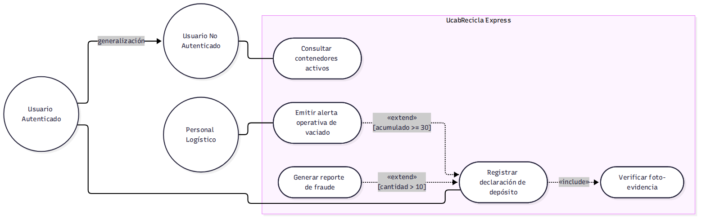

~~~text
### 2. Diagrama de Clases
~~~

~~~text
classDiagram
    class Material {
        <<enumeration>>
        PLASTICO
        ALUMINIO
        CARTON
    }

    class Usuario {
        -idUsuario: String
        +consultarContenedores() void
    }

    class UsuarioAutenticado {
        +seleccionarPuntoVerde() void
        +registrarDeposito(cantidad: int, material: Material, foto: String) void
    }
    Usuario <|-- UsuarioAutenticado

    class PersonalLogistico {
        -idPersonal: String
        +recibirNotificacionVaciado() void
    }

    class PuntoVerde {
        -idPuntoVerde: String
        -ubicacion: String
    }

    class Contenedor {
        -idContenedor: String
        -material: Material
        -capacidadMaxima: int = 30
        -nivelLlenado: int
        +actualizarInventario(cantidad: int) int
        +verificarCapacidad() boolean
    }

    class Deposito {
        -idTransaccion: String
        -cantidadEnvases: int
        -fotoEvidencia: String
        +confirmarDeposito() void
    }

    class ReporteFraude {
        -cantidadDeclarada: int
    }

    class AlertaOperativa {
        -idAlerta: String
        +notificarPersonal() void
    }

    class AppUcabRecicla {
        +registrarDeposito(cantidad: int, material: Material, foto: String) void
    }

    class ControladorDepositos {
        -MAX_ENVASES_FRAUDE: int = 10
        +procesarDeclaracion(cantidad: int, material: Material, foto: String) void
        +evaluarFiltroFraude(cantidad: int) boolean
        +confirmacionVerificacion(resultado: boolean) void
    }

    class ServicioFotoEvidencia {
        +verificarEvidenciaAsync(foto: String) void
    }

    class ConsolaAdministracion {
        +dispararEventoAlerta(idContenedor: String, mensaje: String) void
    }

    %% Relaciones Estructurales
    PuntoVerde "1" *-- "1..*" Contenedor : contiene
    Contenedor "1" <-- "*" Deposito : se registra en
    Contenedor "1" --> "0..*" AlertaOperativa : se refiere a
    AlertaOperativa "*" --> "1" PersonalLogistico : notifica a
    Deposito "*" --> "1" Material : clasifica
    UsuarioAutenticado "1" --> "*" Deposito : realiza
    
    %% Relaciones de Reporte de Fraude
    ControladorDepositos "1" --> "0..*" ReporteFraude : genera
    ReporteFraude "*" --> "1" UsuarioAutenticado : registra a
    
    %% Dependencias de arquitectura y secuencia con multiplicidad
    AppUcabRecicla "1" --> "1" ControladorDepositos : invoca
    ControladorDepositos "1" --> "*" Deposito : crea y gestiona
    ControladorDepositos "1" --> "1" ServicioFotoEvidencia : solicita validación
    ControladorDepositos "1" --> "1" ConsolaAdministracion : alerta a
    ControladorDepositos "1" --> "*" Contenedor : actualiza
    ConsolaAdministracion "1" --> "*" AlertaOperativa : crea
~~~

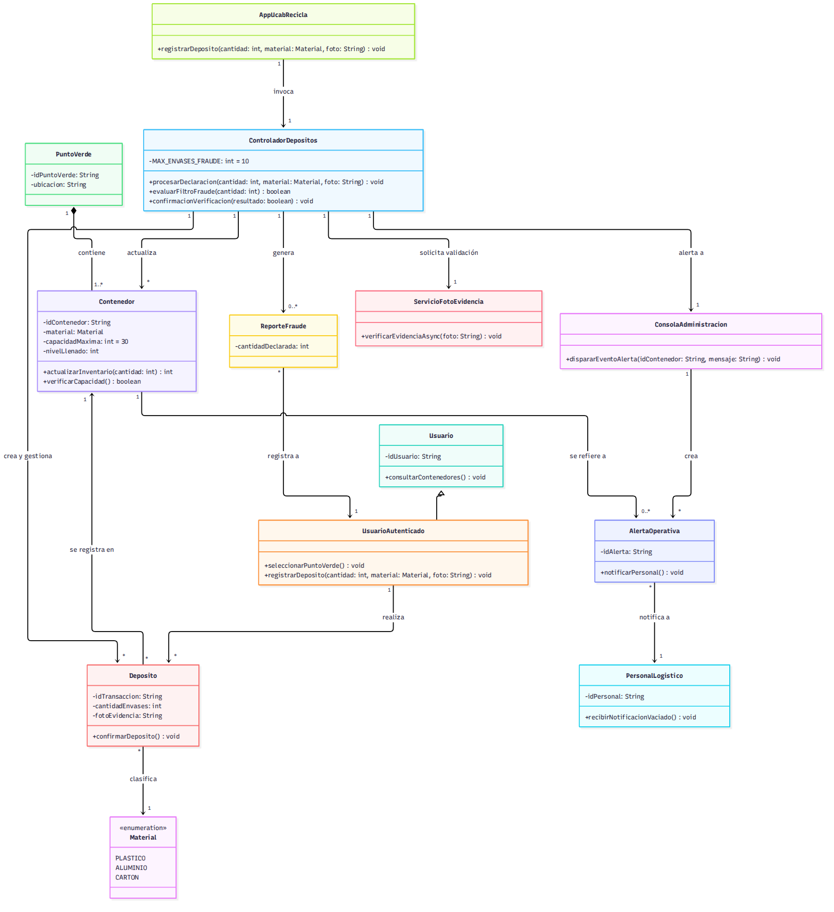

~~~text
### 3. Diagrama de Secuencia
~~~

~~~text
sequenceDiagram
    actor UA as :UsuarioAutenticado
    participant APP as :AppUcabRecicla
    participant CTRL as :ControladorDepositos
    participant DEP as :Deposito
    participant VF as :ServicioFotoEvidencia
    participant CONT as :Contenedor
    participant CONS as :ConsolaAdministracion
    participant ALERT as :AlertaOperativa
    actor PL as :PersonalLogistico

    Note over UA, PL: Precondición: usuario autenticado, punto verde y contenedor activos, foto adjunta y acumulado previo del contenedor = 25.

    UA->>APP: 1: registrarDeposito(5, material, foto)
    activate APP
    
    APP->>CTRL: 1.1: procesarDeclaracion(5, material, foto)
    activate CTRL
    
    %% Autollamada - Filtro Anti-Fraude
    CTRL->>CTRL: 1.1.1: evaluarFiltroFraude(5)
    Note right of CTRL: Cantidad válida (5 <= 10).
    
    %% Creación de la entidad
    CTRL->>DEP: 1.1.2: crear()
    activate DEP
    DEP-->>CTRL: (creado)
    deactivate DEP
    
    %% Llamada Asíncrona
    CTRL-)VF: 1.1.3: «asíncrono» verificarEvidenciaAsync(foto)
    activate VF
    Note right of CTRL: Llamada no bloqueante
    
    %% Retornos de estado sin numeración (COL-2)
    CTRL-->>APP: estado := "Depósito en verificación"
    deactivate CTRL
    APP-->>UA: estado := "Evidencia enviada. Su depósito se está verificando."
    deactivate APP

    Note over VF, CTRL: Transcurren ~1,5 segundos
    
    %% Retorno Asíncrono llamando al método correcto de CTRL (SEC-1)
    VF-)CTRL: 2: «asíncrono» confirmacionVerificacion(OK)
    deactivate VF
    activate CTRL
    
    CTRL->>DEP: 2.1: confirmarDeposito()
    activate DEP
    DEP-->>CTRL: (confirmado)
    deactivate DEP
    
    CTRL->>CONT: 2.2: nuevoAcumulado := actualizarInventario(5)
    activate CONT
    CONT-->>CTRL: (retorna 30)
    deactivate CONT
    
    %% Fragmento de control (Alerta) con sintaxis correcta (SEC-7)
    opt nuevoAcumulado >= 30
        CTRL->>CONS: 2.3: dispararEventoAlerta(idContenedor, "Vaciado Urgente")
        activate CONS
        
        CONS->>ALERT: 2.3.1: crear()
        activate ALERT
        
        %% Método correcto del actor Logístico (SEC-1)
        ALERT->>PL: 2.3.2: recibirNotificacionVaciado()
        activate PL
        PL-->>ALERT: (notificado)
        deactivate PL
        
        ALERT-->>CONS: (creada)
        deactivate ALERT
        
        CONS-->>CTRL: (alertaRegistrada)
        deactivate CONS
    end
    
    deactivate CTRL
~~~

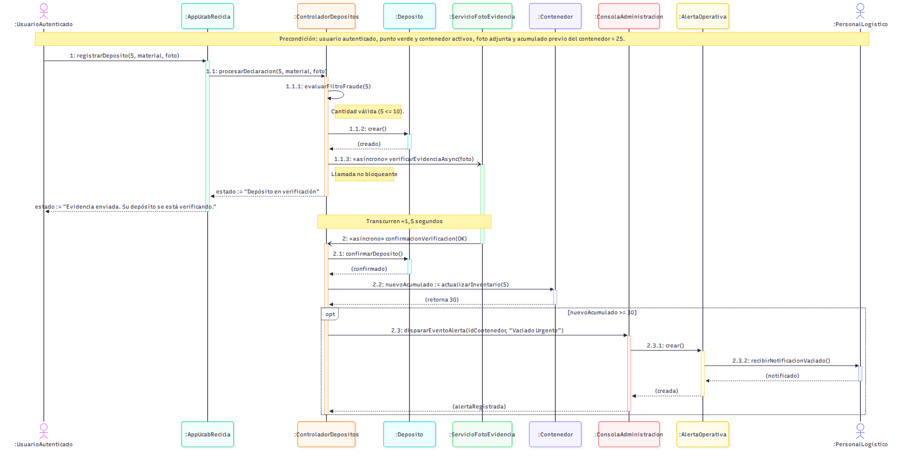

~~~text
### 4. Diagrama de Colaboración (Comunicación)
~~~

~~~text
flowchart LR
    %% Nodos con notación de instancia :Clase
    UA((:UsuarioAutenticado))
    APP[:AppUcabRecicla]
    CTRL[:ControladorDepositos]
    DEP[:Deposito]
    VF[:ServicioFotoEvidencia]
    CONT[:Contenedor]
    CONS[:ConsolaAdministracion]
    ALERT[:AlertaOperativa]
    PL((:PersonalLogistico))

    %% Enlaces con retornos embutidos en la asignación del mensaje
    UA -- "1: estado := registrarDeposito(5, material, foto) ▶" --- APP
    
    APP -- "1.1: estado := procesarDeclaracion(5, material, foto) ▶" --- CTRL
    
    CTRL -- "1.1.1: evaluarFiltroFraude(5) ↺" --- CTRL
    
    CTRL -- "1.1.2: crear() ▶<br>2.1: confirmarDeposito() ▶" --- DEP
    
    CTRL -- "1.1.3: «asíncrono» verificarEvidenciaAsync(foto) ▶<br>◀ 2: «asíncrono» confirmacionVerificacion(OK)" --- VF
    
    CTRL -- "2.2: nuevoAcumulado := actualizarInventario(5) ▶" --- CONT
    
    CTRL -- "2.3: [nuevoAcumulado >= 30] dispararEventoAlerta(idContenedor, 'Vaciado Urgente') ▶" --- CONS
    
    CONS -- "2.3.1: crear() ▶" --- ALERT
    
    ALERT -- "2.3.2: recibirNotificacionVaciado() ▶" --- PL

    %% Estilos
    classDef object fill:#f9f9f9,stroke:#333,stroke-width:2px;
    class APP,CTRL,DEP,VF,CONT,CONS,ALERT object;
~~~

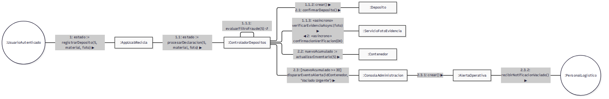

~~~text
---

### Lista de Cambios y Correcciones Realizadas

*   **CU-2**: Se actualizó el texto sobre la línea a `"generalización"` sin usar el estereotipo. (Nota: los diagramas `flowchart` de Mermaid no soportan la línea de generalización con el triángulo hueco como el `classDiagram`; por tanto se representa con línea sólida y la etiqueta explícita tal cual solicitaste).
*   **SEC-1**: 
    * Se cambió el mensaje enviado al Personal Logístico a `2.3.2: recibirNotificacionVaciado()` en la secuencia y colaboración.
    * Se agregó la operación pública `+confirmacionVerificacion(resultado: boolean) void` a la clase `ControladorDepositos` para dar coherencia al mensaje asíncrono de retorno `2`.
*   **COL-2**: Se eliminó la numeración tipo "mensaje nuevo" en los valores de retorno. En el diagrama de secuencia las respuestas asíncronas son simples flechas `-->>` con texto; en el de colaboración se embutió la respuesta como una asignación (`1.1: estado := procesarDeclaracion(...)`).
*   **SEC-6**: Se corrigió el orden temporal. Ahora `1.1.1` es la evaluación de fraude (`evaluarFiltroFraude`) para validar los datos antes del registro, y `1.1.2` pasó a ser la instanciación de la entidad `Deposito` (`crear()`). Se renumeró idénticamente en colaboración.
*   **CL-7**: Se agregaron las asociaciones faltantes en el diagrama de clases (`ControladorDepositos --> Contenedor` y `ConsolaAdministracion --> AlertaOperativa`). Adicionalmente, el vínculo entre `Contenedor` y `AlertaOperativa` se corrigió de "genera" a "se refiere a".
*   **CL-8**: Se agregaron multiplicidades en ambos extremos a las 6 relaciones de dependencia/arquitectura indicadas (`"1" --> "1"`, `"1" --> "*"`, `"1" --> "0..*"`).
*   **CL-9**: El `ReporteFraude` ahora lo "genera" el `ControladorDepositos` (0..*) y el reporte "registra a" un (1) `UsuarioAutenticado`. Se eliminó el `idReporte` y el vínculo con el Depósito; se agregó el atributo de negocio `-cantidadDeclarada: int` a la clase de reporte.
*   **SEC-7**: Se eliminaron los corchetes dobles de la guarda en Mermaid mediante la sintaxis nativa `opt nuevoAcumulado >= 30`.
*   **COL-5**: Se ajustaron los parámetros del método de alerta en el diagrama de colaboración para que fueran exactamente `'Vaciado Urgente'`, haciendo espejo literal con la llamada de la secuencia.
~~~

**Evaluación de la iteración 2**

| Resultado | Errores |
|---|---|
| Corregidos (9) | **SEC-1** (los mensajes ya son operaciones del receptor: `recibirNotificacionVaciado()` y `confirmacionVerificacion()`) · **COL-2** (los retornos ya no se numeran) · **SEC-6** (el filtro va antes de crear el *Deposito*) · **CL-7** · **CL-8** · **CL-9** · **SEC-7** · **COL-5**. En **CU-2** la etiqueta ya dice "generalización", sin estereotipo. |
| Persisten (1) | **CU-2**: la punta de la generalización sigue siendo rellena, no un triángulo hueco. La propia IA explica que el `flowchart` de Mermaid no tiene esa punta, así que es una limitación de la herramienta de renderizado, no un error de modelado. |
| Nuevos o detectados en esta revisión (2) | **CL-10 · Sem · B**: `Contenedor --> AlertaOperativa : se refiere a` tiene la navegabilidad invertida; es la alerta la que se refiere al contenedor. **SEC-8 · Sem · B**: `crear()` de *:Deposito* y de *:AlertaOperativa* no usa «create», y sus líneas de vida empiezan arriba, como si existieran antes de crearse. Este error ya estaba desde la iteración 1 y lo detectamos recién en esta revisión. |

### Iteración 3

**Prompt enviado:**

~~~text
Aplicaste correctamente todas las correcciones de la iteración anterior. Acepto tu explicación sobre CU-2: el flowchart de Mermaid no permite dibujar el triángulo hueco de la generalización, así que lo documentaré como limitación de la herramienta.

En esta revisión encontré dos errores más. Corrígelos sin modificar ningún otro elemento.

CL-10. En el diagrama de clases, Contenedor "1" --> "0..*" AlertaOperativa : se refiere a tiene la navegabilidad invertida respecto de su etiqueta: es la alerta la que se refiere al contenedor (necesita saber qué contenedor hay que vaciar), no al revés. Debe ser AlertaOperativa "0..*" --> "1" Contenedor : se refiere a.

SEC-8. En el diagrama de secuencia, 1.1.2: crear() y 2.3.1: crear() son mensajes de creación, pero :Deposito y :AlertaOperativa tienen línea de vida desde el inicio del diagrama, como si existieran antes de crearse. En UML, la línea de vida de un objeto creado empieza en el mensaje de creación, marcado como «create». Usa "create participant" de Mermaid justo antes de cada mensaje de creación y etiqueta ambos mensajes como «create» (por ejemplo, 1.1.2: «create» crear()). En el diagrama de colaboración, marca esos dos mensajes también como «create», con la misma numeración.

Devuelve el código completo de los diagramas de clases, secuencia y colaboración, cada uno en su propio bloque ```mermaid, con la lista de cambios por ID al final.
~~~

**Respuesta de la IA (sin editar), con el render de cada diagrama:**

~~~text
# Análisis del Caso de Estudio: UcabRecicla Express (Versión Final)

A continuación se presentan los diagramas UML corregidos, garantizando la consistencia entre ellos y el cumplimiento estricto de la notación UML 2.5 y la sintaxis de Mermaid.

### 2. Diagrama de Clases
~~~

~~~text
classDiagram
    class Material {
        <<enumeration>>
        PLASTICO
        ALUMINIO
        CARTON
    }

    class Usuario {
        -idUsuario: String
        +consultarContenedores() void
    }

    class UsuarioAutenticado {
        +seleccionarPuntoVerde() void
        +registrarDeposito(cantidad: int, material: Material, foto: String) void
    }
    Usuario <|-- UsuarioAutenticado

    class PersonalLogistico {
        -idPersonal: String
        +recibirNotificacionVaciado() void
    }

    class PuntoVerde {
        -idPuntoVerde: String
        -ubicacion: String
    }

    class Contenedor {
        -idContenedor: String
        -material: Material
        -capacidadMaxima: int = 30
        -nivelLlenado: int
        +actualizarInventario(cantidad: int) int
        +verificarCapacidad() boolean
    }

    class Deposito {
        -idTransaccion: String
        -cantidadEnvases: int
        -fotoEvidencia: String
        +confirmarDeposito() void
    }

    class ReporteFraude {
        -cantidadDeclarada: int
    }

    class AlertaOperativa {
        -idAlerta: String
        +notificarPersonal() void
    }

    class AppUcabRecicla {
        +registrarDeposito(cantidad: int, material: Material, foto: String) void
    }

    class ControladorDepositos {
        -MAX_ENVASES_FRAUDE: int = 10
        +procesarDeclaracion(cantidad: int, material: Material, foto: String) void
        +evaluarFiltroFraude(cantidad: int) boolean
        +confirmacionVerificacion(resultado: boolean) void
    }

    class ServicioFotoEvidencia {
        +verificarEvidenciaAsync(foto: String) void
    }

    class ConsolaAdministracion {
        +dispararEventoAlerta(idContenedor: String, mensaje: String) void
    }

    %% Relaciones Estructurales
    PuntoVerde "1" *-- "1..*" Contenedor : contiene
    Contenedor "1" <-- "*" Deposito : se registra en
    AlertaOperativa "0..*" --> "1" Contenedor : se refiere a
    AlertaOperativa "*" --> "1" PersonalLogistico : notifica a
    Deposito "*" --> "1" Material : clasifica
    UsuarioAutenticado "1" --> "*" Deposito : realiza
    
    %% Relaciones de Reporte de Fraude
    ControladorDepositos "1" --> "0..*" ReporteFraude : genera
    ReporteFraude "*" --> "1" UsuarioAutenticado : registra a
    
    %% Dependencias de arquitectura y secuencia con multiplicidad
    AppUcabRecicla "1" --> "1" ControladorDepositos : invoca
    ControladorDepositos "1" --> "*" Deposito : crea y gestiona
    ControladorDepositos "1" --> "1" ServicioFotoEvidencia : solicita validación
    ControladorDepositos "1" --> "1" ConsolaAdministracion : alerta a
    ControladorDepositos "1" --> "*" Contenedor : actualiza
    ConsolaAdministracion "1" --> "*" AlertaOperativa : crea
~~~

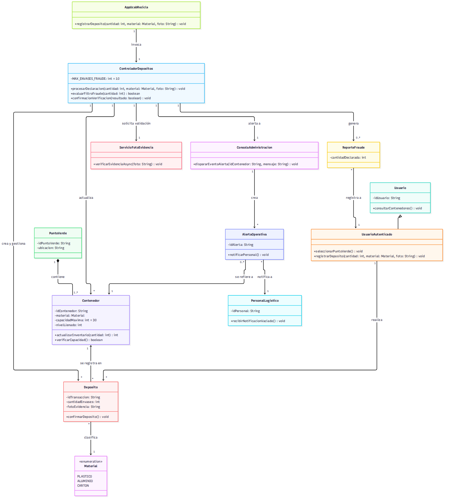

~~~text
### 3. Diagrama de Secuencia
~~~

~~~text
sequenceDiagram
    actor UA as :UsuarioAutenticado
    participant APP as :AppUcabRecicla
    participant CTRL as :ControladorDepositos
    participant VF as :ServicioFotoEvidencia
    participant CONT as :Contenedor
    participant CONS as :ConsolaAdministracion
    actor PL as :PersonalLogistico

    Note over UA, PL: Precondición: usuario autenticado, punto verde y contenedor activos, foto adjunta y acumulado previo del contenedor = 25.

    UA->>APP: 1: registrarDeposito(5, material, foto)
    activate APP
    
    APP->>CTRL: 1.1: procesarDeclaracion(5, material, foto)
    activate CTRL
    
    %% Autollamada - Filtro Anti-Fraude
    CTRL->>CTRL: 1.1.1: evaluarFiltroFraude(5)
    Note right of CTRL: Cantidad válida (5 <= 10).
    
    %% Creación de la entidad
    create participant DEP as :Deposito
    CTRL->>DEP: 1.1.2: «create» crear()
    activate DEP
    DEP-->>CTRL: (creado)
    deactivate DEP
    
    %% Llamada Asíncrona
    CTRL-)VF: 1.1.3: «asíncrono» verificarEvidenciaAsync(foto)
    activate VF
    Note right of CTRL: Llamada no bloqueante
    
    %% Retornos de estado sin numeración
    CTRL-->>APP: estado := "Depósito en verificación"
    deactivate CTRL
    APP-->>UA: estado := "Evidencia enviada. Su depósito se está verificando."
    deactivate APP

    Note over VF, CTRL: Transcurren ~1,5 segundos
    
    %% Retorno Asíncrono llamando al método correcto de CTRL
    VF-)CTRL: 2: «asíncrono» confirmacionVerificacion(OK)
    deactivate VF
    activate CTRL
    
    CTRL->>DEP: 2.1: confirmarDeposito()
    activate DEP
    DEP-->>CTRL: (confirmado)
    deactivate DEP
    
    CTRL->>CONT: 2.2: nuevoAcumulado := actualizarInventario(5)
    activate CONT
    CONT-->>CTRL: (retorna 30)
    deactivate CONT
    
    %% Fragmento de control (Alerta)
    opt nuevoAcumulado >= 30
        CTRL->>CONS: 2.3: dispararEventoAlerta(idContenedor, "Vaciado Urgente")
        activate CONS
        
        create participant ALERT as :AlertaOperativa
        CONS->>ALERT: 2.3.1: «create» crear()
        activate ALERT
        
        %% Método correcto del actor Logístico
        ALERT->>PL: 2.3.2: recibirNotificacionVaciado()
        activate PL
        PL-->>ALERT: (notificado)
        deactivate PL
        
        ALERT-->>CONS: (creada)
        deactivate ALERT
        
        CONS-->>CTRL: (alertaRegistrada)
        deactivate CONS
    end
    
    deactivate CTRL
~~~

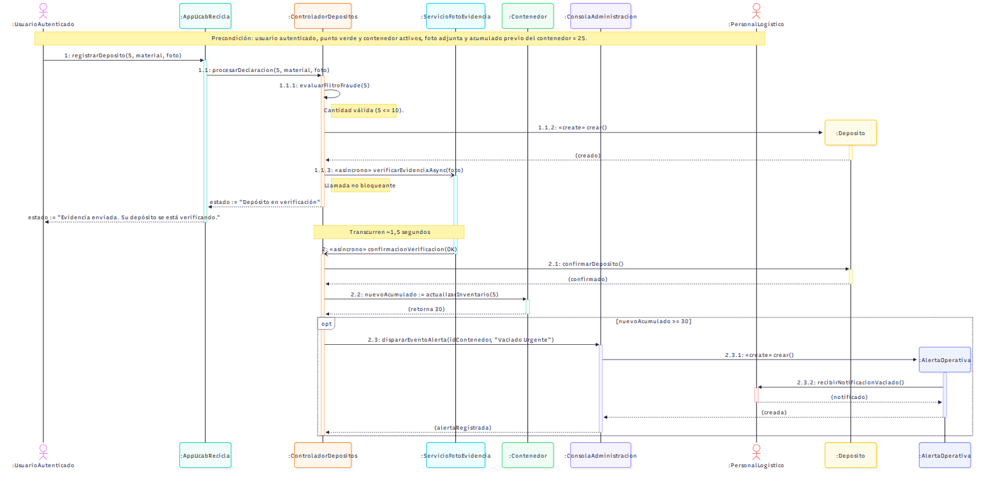

~~~text
### 4. Diagrama de Colaboración (Comunicación)
~~~

~~~text
flowchart LR
    %% Nodos con notación de instancia :Clase
    UA((:UsuarioAutenticado))
    APP[:AppUcabRecicla]
    CTRL[:ControladorDepositos]
    DEP[:Deposito]
    VF[:ServicioFotoEvidencia]
    CONT[:Contenedor]
    CONS[:ConsolaAdministracion]
    ALERT[:AlertaOperativa]
    PL((:PersonalLogistico))

    %% Enlaces con retornos embutidos en la asignación del mensaje
    UA -- "1: estado := registrarDeposito(5, material, foto) ▶" --- APP
    
    APP -- "1.1: estado := procesarDeclaracion(5, material, foto) ▶" --- CTRL
    
    CTRL -- "1.1.1: evaluarFiltroFraude(5) ↺" --- CTRL
    
    CTRL -- "1.1.2: «create» crear() ▶<br>2.1: confirmarDeposito() ▶" --- DEP
    
    CTRL -- "1.1.3: «asíncrono» verificarEvidenciaAsync(foto) ▶<br>◀ 2: «asíncrono» confirmacionVerificacion(OK)" --- VF
    
    CTRL -- "2.2: nuevoAcumulado := actualizarInventario(5) ▶" --- CONT
    
    CTRL -- "2.3: [nuevoAcumulado >= 30] dispararEventoAlerta(idContenedor, 'Vaciado Urgente') ▶" --- CONS
    
    CONS -- "2.3.1: «create» crear() ▶" --- ALERT
    
    ALERT -- "2.3.2: recibirNotificacionVaciado() ▶" --- PL

    %% Estilos
    classDef object fill:#f9f9f9,stroke:#333,stroke-width:2px;
    class APP,CTRL,DEP,VF,CONT,CONS,ALERT object;
~~~

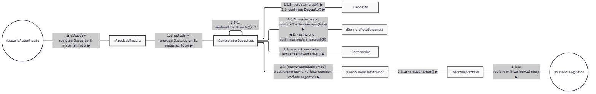

~~~text
---

### Lista de Cambios por ID

*   **CL-10**: En el diagrama de clases, invertí la navegabilidad de la relación para que refleje correctamente la dependencia de la alerta hacia el contenedor: `AlertaOperativa "0..*" --> "1" Contenedor : se refiere a`.
*   **SEC-8**:
    *   **Secuencia:** Eliminé a `:Deposito` y `:AlertaOperativa` de las declaraciones iniciales del diagrama para que no tengan línea de vida desde el principio. Utilicé `create participant` justo antes del llamado a `crear()` y agregué el estereotipo `«create»` en los mensajes `1.1.2` y `2.3.1`.
    *   **Colaboración:** Agregué el estereotipo `«create»` a los mensajes `1.1.2` y `2.3.1`, manteniendo coherencia exacta con la secuencia.
~~~

**Evaluación de la iteración 3**

| Resultado | Errores |
|---|---|
| Corregidos (2) | **CL-10**: la relación ahora es `AlertaOperativa "0..*" --> "1" Contenedor`. **SEC-8**: se usa `create participant`, así que las líneas de vida de *:Deposito* y *:AlertaOperativa* empiezan en su mensaje «create», también marcado en la colaboración. Gemini solo cambió las líneas que le pedimos. |
| Persisten: limitación de la IA y la herramienta (1) | **CU-2 · S · B**: la generalización entre actores se dibuja con punta rellena, no con triángulo hueco. El `flowchart` de Mermaid no tiene esa punta (Mermaid no tiene diagrama de casos de uso nativo) y la IA no encontró otra forma de representarla. |
| Nuevos (0) | Ninguno. Al crear los participantes, Mermaid los ubica al final, a la derecha del diagrama de secuencia. Es un efecto visual, no un error UML. |

El diagrama de casos de uso no se envió en esta iteración porque su único error pendiente (CU-2) ya se había aceptado como limitación. Su versión final es la de la iteración 2.

### Diagramas finales de la IA


El diagrama de casos de uso final es el de la iteración 2; los otros tres, los de la iteración 3.

<div class="page-break"></div>

## 7. Conclusión reflexiva

Gemini generó desde el primer intento código Mermaid que renderizaba, y de los 29 errores que identificamos solo 5 fueron sintácticos; el resto fue semántico: fusionó Punto Verde y Contenedor, desconectó la secuencia del diagrama de clases, creó el depósito antes del filtro anti-fraude y vinculó el reporte de fraude a un depósito que, según el caso, nunca se registra. La IA domina la forma de la notación mejor que su significado: produce diagramas que se ven correctos aunque contradigan las reglas de negocio, afirmó haber corregido errores que seguían presentes y, al corregir, introdujo seis errores nuevos. Además, Mermaid no tiene diagramas de casos de uso ni de colaboración, y la generalización entre actores nunca pudo dibujarse con triángulo hueco. Con tres iteraciones de citas precisas se corrigieron todos los errores de modelado. La comparación también expuso nuestras fallas, que registramos como correcciones a nuestro modelo: faltaban la frontera del sistema, la clase Declaración, la alerta por llenado y la asincronía; usamos «extend» para la autenticación, y nuestra colaboración era en realidad otra secuencia. La IA sirve como borrador y como revisor, pero la validación semántica sigue siendo responsabilidad del modelador.
